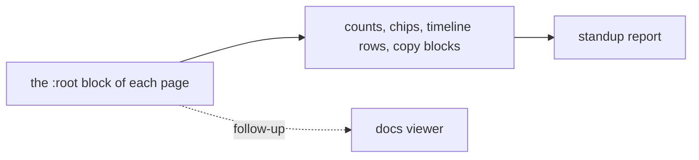

# DESIGN - mission-control's own pages

The pages the skills generate and open on the founder's machine: the standup
report today, the docs viewer next. Instance of
`framework/kit/templates/_design.template.md`, judged by
`framework/design-standard.md`.

## Identity

A report or a document read once, quickly, on the operator's own machine,
often while confidential: never online, never branded, never decorated.

**The deciding sentence:** a page that opens offline and is read in one pass:
quiet ground, one accent, state carried by tinted chips, nothing loaded from
anywhere.

## Tokens - the `:root` block at the top of each generated page

Self-contained by contract, so each page carries its tokens inline; this file
is where their values are decided. A neutral with a slight blue-green bias,
never a stock grey, so the page reads as chosen.

| Role | Light | Dark | Use | Lowest contrast pair |
|---|---|---|---|---|
| `bg` | `#FFFFFF` | `#111819` | page ground | |
| `surface` | `#F1F5F5` | `#182123` | counts, code, panels | |
| `line` | `#D3DDDE` | `#2B3A3D` | rules, borders | decorative only |
| `ink` | `#1B2A2E` | `#E4EDEE` | text | 14.8:1 / 15.1:1 |
| `ink-soft` | `#44575C` | `#B3C3C6` | secondary text | 6.9:1 / 9.0:1 on surface |
| `ink-faint` | `#56696E` | `#94A8AC` | provenance, captions | 5.3:1 / 6.6:1 on surface |
| `accent` | `#0A6A70` | `#5CC4CB` | links, the one active control | 6.3:1 / 8.7:1 |
| state pairs | merged, open PR, new, event, out | | chips: ink on its own tint | all at or above 5.25:1 |

**Spacing scale:** `--s1` .25 · `--s2` .5 · `--s3` .75 · `--s4` 1 · `--s5` 1.5 · `--s6` 2 · `--s7` 3 rem.
**Type scale:** `--t-xs` .75 · `--t-sm` .82 · `--t-md` .9375 · `--t-lg` 1.4 rem; system faces only
(`--sans`, `--mono`), because a web font is a remote load and the pages must open offline.

## Components

| Component | States | Notes |
|---|---|---|
| Count chip | per state | ink on the state's own tint, never colour alone: the label carries the state |
| Filter button | off, on, focus | on = ink fill; one active at a time |
| Day section | open, collapsed | a `
`, so it works without script and from the keyboard |
| Copy block | idle, copied, copy refused | a refused clipboard falls back to selecting the text |

## State matrix

| View | Empty | Loading | Error | Long content | Direction | Narrow |
|---|---|---|---|---|---|---|
| Standup report | "Nothing moved in this window" with the window shown | none, the page is static | the sources list names what could not be read | titles wrap; code and URLs scroll in their own block | LTR only, stated | 360 px, one column |

## Quality bar

- Contrast: every pair above at 4.5:1 or more in both themes, recomputed when a value changes.
- Themes: light and dark, following the system setting.
- Offline: no http(s) string other than the report's own tracker and PR links.
- Accessibility: keyboard reachable without script; focus visible on every control.

The docs viewer's page is generated from inside its skill and does not yet draw
from this file; moving it here is the named follow-up.
