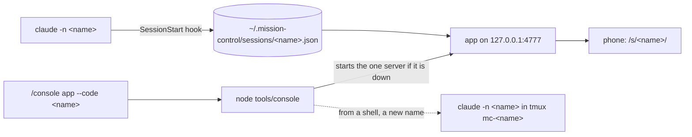

# Console



Every terminal session is a Flight, told apart by its name (`claude -n <name>`).
The app shows each one by reading its transcript, and types into the ones that
run in tmux. There are no Controllers, no staffing and no call, retune or poll
verbs: a second piece of work is a second terminal with a second name.

## Run it

From the portfolio's root (`$CLAUDE_PROJECT_DIR`); the script has no exec bit
in a clone, so run it through node:

```
node tools/console app --code <name>    # print the app link for the named session
node tools/console app stop             # stop the app server
node tools/console list                 # registered sessions: name, alive or dead, role, folder
```

- **Inside a session** (`/console app --code <name>`): the session hook has
  already bound the name to this session from the prompt, so run the command
  and give the founder the printed link. The link carries the app token: print
  it once, never into a file, a commit or a ticket. A session that does not run
  in tmux is shown read-only; the command says so. To type into it from the
  phone, end it and open it from a shell with the same command.
- **From a shell**: a name nothing runs under is launched, `claude -n <name>`
  in a detached tmux session `mc-<name>` in the current folder, and registered
  by its hook; a running one is reused. Attach with `tmux attach -t mc-<name>`.
  `MCAPP_CLAUDE_CMD` replaces `claude` (extra flags), `MCAPP_TMUX_SOCKET` names
  a private tmux server, `MCAPP_PORT` and `MCAPP_HOME` move the app.
- **No name given**: `/console app` alone is `--code <this session's name>`;
  ask for the name when the session has none (`claude -n` was not used).

## What it needs

- The hooks in `.claude/settings.json` (session registration, the push-to-base
  guard). A session started in another folder registers only when the hook is
  also wired in user settings; `CHANGELOG.md` has the step.
- `tmux` for typing from the app (`brew install tmux`); without it the app
  still reads every session.
- `node` on PATH; nothing else.

## Out of scope

Pricing and spend: `/spend`. Sharing a file with the phone: `/share`.
