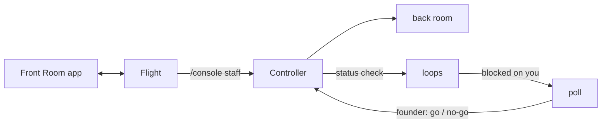

# Console

The orchestrator session is **Flight**. Each **Controller** owns one front or
one project of a front, staffed on a **console** with a call sign. A
Controller's own sub-agents are its **back room**; messages between them are
the **loops**; whatever needs the founder lands in the **go/no-go poll**; the
The **Mission Control App** is the Front Room (the console's own name for it).

## Commands (the console tool takes the same arguments)

| Command | What it does |
|---|---|
| `/console staff <front> [--project 
] [--model haiku\|sonnet\|opus\|fable] [--effort low\|medium\|high\|xhigh\|max] [--budget <n>] [--cwd <dir>]` | starts a Controller as the `mission-fleet:controller` agent type, in its scope's repo directory (or `--cwd`), with a staffing order naming the hub, spokes, progress log and back-room budget; `--budget` is a whole number from 0 to 20, default 4 |
| `/console list` | the fleet: state, the model its last request ran on, type, scope |
| `/console call <sign> <message>` | a message to one Controller; its answer comes back as a status check |
| `/console retune <sign> <model\|-> [<effort>]` | changes model and effort from the Controller's next request |
| `/console poll` · `/console loops [<sign>]` | what waits on the founder; recent traffic |
| `/console go\|nogo <id> [note]` | **the founder's alone**: refused when Flight's model sends it |
| `/console dismiss-gate <id>` | **the founder's alone**: closes a poll item that no longer matters; no verdict is sent to the Controller |
| `/console answer <n\|text>[ \| <n\|text>]` | **the founder's alone**: answers a question Flight sent to the app, from the Mac (an option number or free text, ` \| ` between several questions) |
| `/console stand-down <sign>` | a dated handoff to the front's progress log, then the end |
| `/console dismiss <sign>` | the end, nothing written (tests, or no work done) |
| `/console app [stop]` | **the founder's alone**: starts the Front Room on 127.0.0.1 and makes it a standing setting for this profile: it starts in every session of the profile, restarts after a plugin reload or a crash, and `/console app stop` stops it and turns the setting off |

## How Flight staffs

1. **Size it first** (Prime Directive 5): one line, `<n> Controllers x <model> x <effort>, back-room budget <b> each`, and the founder's go. The budget granted at staff time is the Controller's envelope for its back room; a spawn beyond it is refused by the mod and audited, and the Controller reports it as a blocker so the founder can grant more (restaff with a larger `--budget`).
2. **Cheapest model that holds the bar**, retuned on evidence: a Controller doing mechanical work runs on haiku; retune up when its reports show it struggling, down when the hard part is done.
3. **One console per scope.** A multi-project front gets one console per project that has work, or one front console that runs in the directory its projects share.
4. **Stand down when the work ends.** A console left staffed costs nothing while idle but its context grows; the progress log is its memory, so a new console starts cold without loss.

## Flight's duties while consoles run

- **Route advisories.** A Controller's `contract:` line opens an advisory naming the fronts whose `_map.md` names its scope. On the founder's go it reaches the dependent consoles, or waits for them to be staffed.
- **Single writer.** Only Flight writes `_command/trackers/fronts.md`, `_command/daily/today.md` and `_command/fleet/`; Controllers propose, Flight writes.
- **The day's edges read the fleet.** `/briefing` and `/debrief` read each staffed console's last status (`/console list`, `/console loops <sign>`) and the open go/no-go items (`/console poll`), and put a Controller blocked on the founder first. `/standup` and `/retro` read git, the tracker and the boards only. Between them, use `/console list`, `/console poll` and `/console call <sign> <message>`.
- **Verify before relaying.** A Controller's state is only as fresh as its front's files; check a PR's real state (`gh pr view`) before reporting it to the founder.
- **Never answer a gate.** Go and no-go are typed by the founder or sent from the app.

## Alerts and watches

A Controller's report that opens a **new** gate sends one fixed line to the
founder (desktop, or the phone while Remote Control is connected). A PR a
Controller names in its own `state:` or `shipped:` line is watched every ten
minutes; once its checks finish, a change in state, reviews, comments or check
results wakes that Controller to act and report. Merged or closed PRs and
stood-down consoles drop out of the watch.

## What the guard enforces, and what it does not

The mission-fleet guard refuses, for Controllers and their back rooms: unpinned git and gh calls (every call is `cd <repo> && git ...` or `git -C <repo> ...`), pushes to base or deploy branches, force pushes and deletions, stash, PR merges, writes to Flight's files, the Claude CLI, the app's port and other processes' environments. What a Controller may do inside its scope: commit, push its own feature branches and open PRs; it never merges a PR (`controller.ts`, `guards.ts`). In git, a back room may only read, add and commit. The guard is a text guard: it catches mistakes and steered agents, and it is **not a sandbox**. Base branches are held by server-side branch protection with administrators included (`framework/remote-access.md`).

## Remote

The Front Room on the founder's phone goes through `tailscale serve` only:
`framework/remote-access.md`.
