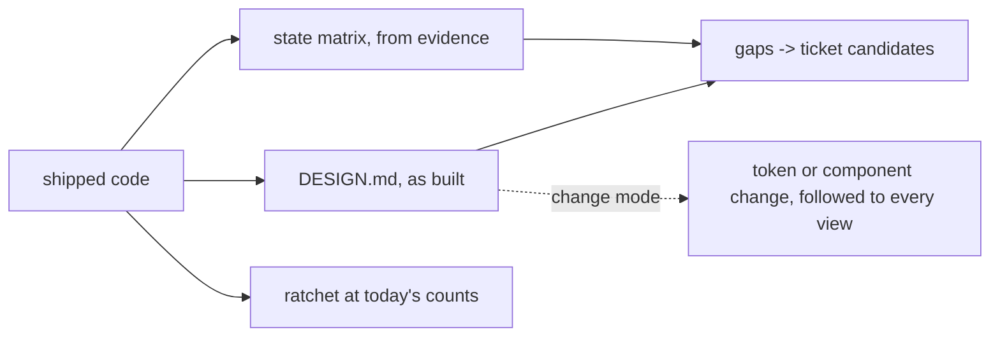

# Design adopt

An existing product already has a design; it is just unwritten and
unchecked. This skill writes it down as the contract
`framework/design-standard.md` defines, then makes drift one-way. It changes
nothing a user sees.



## Invocation

```
/design-adopt --front <f> [--project <p>] [--change "<token or component change>"]
```

**Scope guard.** `--front` is required, and the skill reads and writes only
that front's repo, in a worktree off its recorded base branch when another
checkout is in use (inside the front's folder, never at the top of `fronts/`:
`framework/task-board.md`, front placement). When a delivery flow calls it, it
inherits that flow's front and never widens it.

## Adopt mode

1. **Read before writing.** The front's hub, spoke and agent file; then the
   code that carries the design: stylesheets and token files, theme objects,
   the shared components, the routes. Note what the repo already enforces
   (a palette test, a lint rule) - that idiom is kept, not duplicated.
2. **DESIGN.md, as built.** From `framework/kit/templates/_design.template.md`,
   recording what the code does, not what it should do. Every value names
   its source file. The deciding sentence comes from the product's job, not
   from taste. Executor where installed: the impeccable documenter, which
   derives the file from the shipped artifact.
3. **State matrix from evidence.** For each data-bearing view, each of the
   six states is either designed (point at the code) or **not designed**,
   stated plainly. A guess is never written into the matrix.
4. **Ratchet at today's count.** Measure raw colour, spacing and type values
   outside the token files, with `tools/token-lint.sh` or, where the repo has
   its own test idiom, a test in that idiom. Cross-check the count with the
   second counter before recording it. Show the ratchet red with one value
   added and green after removing it.
5. **Gaps.** Each undesigned state, missing scale, inaccessible pair or
   hand-rolled control becomes a one-line ticket candidate with its source
   (the standard's principle or the WCAG criterion), handed to `/triage`.
   Nothing is fixed here.

## Change mode (`--change`)

For a front that already has a DESIGN.md: one token or component change,
end to end. Name the change and why, find every view that uses the token or
component (grep the token name and the component's imports), update the
DESIGN.md entry and the inventory, and list the views whose comps change.
Run as part of a `/mission-flow` ticket, which owns the code change and its
Phase 6 rendered check; this mode supplies the ripple list and the contract
update.

## Outputs

The DESIGN.md, the ratchet with its baseline and its red-green proof, and
the gap list. On a front with a remote these land through that front's own
flow; this skill never pushes and never merges.
