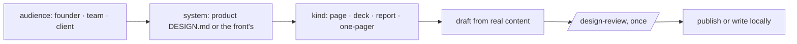

# Design artifact

An artifact is read by someone who did not watch the work. It earns the same
design care as a product view: a deciding sentence, tokens, hierarchy, every
state it can be in. The rules are `framework/design-standard.md`'s; the
values are the product's own (`.claude/skills/DESIGN.md`) unless the artifact
speaks for one front, in which case that front's DESIGN.md. The Mission
Control App has its own system, `tools/app/DESIGN.md`, derived from the
product's and extending its palette with state pairs.



## Invocation

```
/design-artifact <what and for whom> [--front <f>] [--kind page|deck|report|one-pager]
                 [--local]
```

## Steps

1. **Audience first.** Name who reads it and what they do next because of
   it. That one sentence is the artifact's deciding sentence.
   - **The founder:** dense, candid, working vocabulary allowed.
   - **A team:** outcome first, terms defined, no instance paths, no
     internal process vocabulary (the leak-guard terms apply).
   - **A client:** the team rules plus nothing from another front, no
     private context, and the client's own brand only when they supplied it.
2. **Confidentiality gate.** A front marked confidential, or anything from
   the private instance files, goes `--local` by default: a self-contained
   file in the scratchpad, opened locally, no upload. Publishing it needs the
   founder's word in the moment.
3. **System.** Tokens from the chosen DESIGN.md, both themes unless the
   system commits to one. A deck uses the published slides type where one is
   available; a page or report is a single self-contained file.
4. **Real content only.** Every number traced to its source, every claim to
   evidence; nothing is invented to fill a layout. A figure that could not be
   verified is labelled as such in the artifact.
5. **States.** An artifact has them too: empty sections, very long lists,
   narrow screens, print-free sharing. Each is handled, not hoped for.
6. **Review once.** `/design-review --mode proposal` on the draft; fix what it
   finds, then deliver. No loop.

Executors where installed: the artifact design guidance, the dataviz skill
for charts, the slides and document types for decks and docs, the doc-voice
skill for a team or client register.

## Outputs

A private published link, or the local file path under `--local`, plus one
sentence on who it is for. Sharing beyond the founder is the founder's act.
