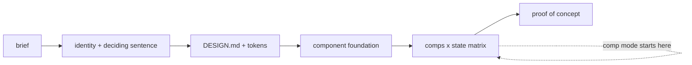

# Design new

The design standard (`framework/design-standard.md`) says what good UI work
is; this skill does it for something that does not exist yet. Every rule
lives in the standard; this file says the order and the outputs.



## Invocation

```
/design-new <idea or brief> [--front <f>] [--platform web|mobile|both]
            [--comp <view or pattern>] [--local] [--stack-neutral]
            [--thinking ...] [--verbosity ...]
```

- **Full mode** (default): a product from nothing.
- **Comp mode** (`--comp`): one new view or pattern inside a front that
  already has a DESIGN.md. Skips straight to the comps step against that
  file. This is the mode the delivery flows call.
- **`--local`**: the proof is written to the scratchpad and opened on the
  founder's machine; nothing is published. The default for any product that
  has not launched.
- **`--stack-neutral`**: no stack is chosen yet, so tokens are written in the
  DTCG format only and the component foundation is named as a requirement
  ("accessible primitives for a web app"), not a package. A later step
  converts them once the stack is chosen.

**Scope guard.** The skill writes only inside the front `--front` names, or,
with no front, only to the session scratchpad and published artifacts. It
never uses another front's repo as a reference implementation or a test bed.

## Full mode

1. **Brief.** Restate the product in four lines: who, where, how often, the
   one job. Ask only for what cannot be inferred; under `--auto`, state the
   assumptions and continue.
2. **Identity.** The deciding sentence (the standard's DESIGN.md contract),
   then palette, type and spacing as tokens, chosen from the subject's own
   world, never a default. Each text pair's contrast is computed, not
   asserted. Executors where installed: the impeccable skill's design step;
   the frontend-design and mobile-app-ui-design skills for direction.
3. **DESIGN.md.** From `framework/kit/templates/_design.template.md`, filled.
   The token file is written in the front's stack format and mirrored in the
   DTCG format the standard names; under `--stack-neutral`, DTCG only.
4. **Component foundation.** Name the mature foundation for the stack (the
   standard's guidance) and why; hand-rolled controls need a reason. Under
   `--stack-neutral`, name the requirement instead.
5. **Comps.** The key screens, each with its row of the six-state matrix:
   empty, loading, error, long content, direction, narrow. Mobile follows the
   DESIGN.md platform section (HIG and Material behaviour, never their look).
6. **Proof of concept.** One clickable page showing the key screen in every
   state from one token set; on `--platform both`, web and mobile side by
   side from one model. Under `--local`, written to the scratchpad only;
   otherwise published as a private artifact, or written to the scratchpad
   where publishing is not available.
7. **Self-review.** Run `/design-review --mode proposal` on the proof before
   presenting it; fix what it finds once, then present. No loop. A calling
   flow relies on this review and does not run its own.

## Comp mode

Read the front's DESIGN.md first. Produce, for the one view or pattern: the
comp, its six-state row, the components it reuses and any it adds (added
components go into the DESIGN.md inventory in the same ticket), and the
contrast of any new pair. A choice the DESIGN.md does not settle - a new
pattern, a new component family, an identity change - is a design fork:
return it as such to the calling flow, which stops on it.

## Outputs

Full mode: the DESIGN.md, the token file, the comps, the proof link. Comp
mode: the comp and its state row, written into the calling ticket's folder
and referenced from its Phase 1 record.
