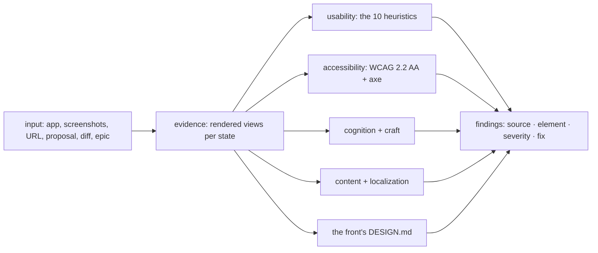

# Design review

A design finding names the principle it breaks and the element that breaks
it. "Looks off" is not a finding; "H5, nothing stops choosing a day with no
slot, the Mon chip" is. The sources and the DESIGN.md contract are
`framework/design-standard.md`'s; this skill applies them.



## Invocation

```
/design-review <target> [--front <f>] [--mode product|proposal|diff|epic]
               [--triage] [--spend lean|standard|deep]
```

- **product** (default): a running product, a URL or screenshots.
- **proposal**: a mockup, a deck or a written spec, judged before it is
  built. Findings that need behaviour to judge are marked as such.
- **diff**: the design lens for one ticket. Input is the diff file, the
  comp, and the rendered screenshots Phase 6 or Phase 4 produced. Rides a
  weak-tool agent with files only, never a live tree.
- **epic**: one pass over every view an epic touched, looking for what
  per-ticket lenses cannot see: two fragments styling the same thing two
  ways, a token added twice under two names, states designed in one view
  and not its sibling.

**Scope guard.** Reads only the target named, and the DESIGN.md of the front
named. A running app is driven on the stack the front's spoke names, never a
production URL unless the founder asks in the moment.

## The lenses

Every finding carries: the source, the element, the severity (blocks, harms,
polish), and the smallest fix.

1. **Usability** - the ten heuristics, cited by number.
2. **Accessibility** - WCAG 2.2 AA: contrast computed from the actual
   values, target size, focus visible and not obscured, names and roles,
   reflow at the narrowest width. axe-core where a browser is available; a
   violation axe finds is quoted, not paraphrased.
3. **Cognition and craft** - Laws of UX for placement and choice count;
   Refactoring UI for hierarchy, spacing and type: one primary action per
   view, hierarchy by weight and colour before size, values on the scale.
4. **Content and localization** - every label says what it does; errors say
   what happened and how to recover; empty states say what will appear and
   how to fill it; right-to-left layouts mirror, including directional
   icons; numbers, dates and digits follow the locale the product chose;
   long translations wrap instead of clipping.
5. **The contract** - where the front has a DESIGN.md: raw values where a
   token exists, components outside the inventory, any of the six states
   undesigned. Where it has none, say so as the first finding and point at
   `/design-adopt`.

**Evidence before findings.** Render each reviewed view in each state its
matrix row lists before judging it; a state that cannot be reached is
reported as unreachable, not assumed fine. Executors where installed: the
impeccable skill's critique and audit steps, the Playwright browser tools
for rendering, axe-core for the automatic checks.

## Spend

Under `--spend lean`, a review of an unchanged view may run inline. A new
view, a new component, or an accessibility finding is never waived by any
spend dial: a dial that can skip them is not a spend dial.

## Outputs

A report ordered by severity, each finding with its source and element.
Product and proposal modes publish it as a page when asked, or write it to
the scratchpad. `--triage` hands blocking and harming findings to `/triage`
as ticket candidates. Diff and epic modes return a record to the calling
flow, in the record format its dispatches use.
