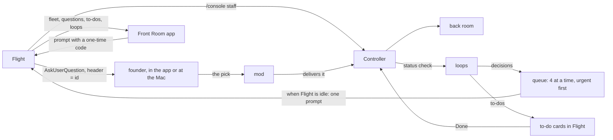

# Fleet

This skill is the guide to the `/console` commands. They belong to the
mission-fleet mod, so the skill carries a different name: a skill named
`console` would take `/console` from the mod, and a typed command could then
load this text instead of running.

The orchestrator session is **Flight**. Each **Controller** owns one front or
one project of a front, staffed on a **console** with a call sign. A
Controller's own sub-agents are its **back room**; messages between them are
the **loops**; whatever needs the founder Flight asks as **its own question**
(AskUserQuestion), one per decision with the options the Controller wrote,
and each action only the founder can take is a **to-do** in Flight; the
**Mission Control App** is the Front Room (the console's own name for it).

## Commands (the console tool takes the same arguments, plus `--code <code>` when the app relays one)

| Command | What it does |
|---|---|
| `/console staff <front> [--project 
] [--model haiku\|sonnet\|opus\|fable] [--effort low\|medium\|high\|xhigh\|max] [--budget <n>] [--cwd <dir>]` | starts a Controller as the `mission-fleet:controller` agent type, in its scope's repo directory (or `--cwd`), with a staffing order naming the hub, spokes, progress log and back-room budget; `--budget` is a whole number from 0 to 20, default 4 |
| `/console list` | the fleet: state, the model its last request ran on, type, scope |
| `/console call <sign> <message>` | a message to one Controller, taken whole: words that start with two dashes and new lines reach it as written; its answer comes back as a status check |
| `/console retune <sign> <model\|-> [<effort>]` | changes model and effort from the Controller's next request |
| `/console poll` · `/console loops [<sign>]` | what waits on the founder, each open question with its numbered options and each to-do (read-only; Flight asks the questions); recent traffic |
| `/console done <id>` | **the founder's alone**: checks off a to-do and tells the Controller that left it |
| `/console dismiss-gate <id>` | **the founder's alone**: closes a question or to-do that no longer matters; nothing is sent to the Controller |
| `/console answer <n\|text>[ \| <n\|text>]` | **the founder's alone**: answers a question Flight sent to the app, from the Mac (an option number or free text, ` \| ` between several questions); a Controller's question is answered this way too |
| `/console stand-down <sign>` | asks the Controller for a dated handoff to the front's progress log and lists it stood down as soon as the request is delivered; the Controller writes the handoff, reports it and ends |
| `/console dismiss <sign>` | the end, nothing written (tests, or no work done) |
| `/console app [stop]` | **the founder's alone**: starts the Front Room on 127.0.0.1 and makes it a standing setting for this profile: it starts in every session of the profile, restarts after a plugin reload or a crash, and `/console app stop` stops it and turns the setting off |

## How Flight staffs

1. **Size it first** (Prime Directive 5): one line, `<n> Controllers x <model> x <effort>, back-room budget <b> each`, and the founder's go. The budget granted at staff time is the Controller's envelope for its back room; a spawn beyond it is refused by the mod and audited, and the Controller reports it as a blocker so the founder can grant more (restaff with a larger `--budget`).
2. **Cheapest model that holds the bar**, retuned on evidence: a Controller doing mechanical work runs on haiku; retune up when its reports show it struggling, down when the hard part is done.
3. **One console per scope.** A multi-project front gets one console per project that has work, or one front console that runs in the directory its projects share.
4. **Stand down when the work ends.** A console left staffed costs nothing while idle but its context grows; the progress log is its memory, so a new console starts cold without loss.
5. **Auto mode needs no switch.** The auto mode classifier gives no verdict on a call a plugin raises, so the fleet approves its own: a Controller spawn under a console name it is staffing, and a message to a staffed Controller. Settings rules and the other hooks still decide first; only the ask the mode cannot settle becomes an allow. Each approval leaves an `approve` line with the call sign in the fleet's audit log. A call to a fleet seat that the fleet does not approve, because it was raised outside the fleet's own loop or a rule beneath denied it, leaves an `approve-miss` line with the reason and is decided as usual.

## Flight's duties while consoles run

- **Route advisories.** A Controller's `contract:` line opens an advisory naming the fronts whose `_map.md` names its scope. It is asked as Tell them or Don't tell; on Tell them it reaches the dependent consoles, or waits for them to be staffed. A `contract:` line with no dependent front opens nothing.
- **Ask what the fleet puts to you.** A prompt that starts `[mission-fleet]` lists up to four Controllers' questions, each with its id and options. Ask them before anything else, in one AskUserQuestion call: each header exactly its id, the question and options exactly as given. The fleet delivers each answer to its Controller and puts a line after the tool's result saying what became of it; when a delivery failed, that line says how to relay it (`/console call <sign> <the answer>`).
- **Single writer.** Only Flight writes `_command/trackers/fronts.md`, `_command/daily/today.md` and `_command/fleet/`; Controllers propose, Flight writes.
- **The day's edges read the fleet.** `/briefing` and `/debrief` read each staffed console's last status (`/console list`, `/console loops <sign>`) and the open questions and to-dos (`/console poll`), and put a Controller blocked on the founder first. `/standup` and `/retro` read git, the tracker and the boards only. Between them, use `/console list`, `/console poll` and `/console call <sign> <message>`.
- **Verify before relaying.** A Controller's state is only as fresh as its front's files; check a PR's real state (`gh pr view`) before reporting it to the founder.
- **Mark a message about Controllers.** When a message to the founder is about one or more Controllers, its first line is their call signs in bold, spelled as `/console list` shows them, on a line of their own and joined by a middle dot: `**MISSION-CONTROL**`, or `**<CALL-SIGN> · <CALL-SIGN>**` for several. The Front Room badges the message with each one in its Controller's colour, the colour it also wears on Consoles and Loops; the terminal shows the line as a bold header. A message in which Flight speaks for itself carries no marker. A name the fleet does not know, or a bold first word, stays text and badges nothing. The console tool's description carries the same rule.
- **Never answer a question.** An answer is the founder's, picked in the question Flight asks; Flight never picks one or sends one itself. Ask the founder in chat when a question needs explaining, and leave the answer to them.

## What a Controller's report opens

A Controller's status check may add, below its four lines, a `decisions:`
block, a `notes:` line and a `for you to do:` block:

    decisions:
    - Retry failed card charges once, or three times? | 1) Once: fewer duplicate-charge risks | 2) Three times: recovers more revenue
    notes: the leak sweep found 0 hits
    for you to do:
    - Close PR #31, superseded by #37 https://github.com/OWNER/REPO/pull/31

- Each `decisions:` line opens one question with its options (two to four,
  the most AskUserQuestion shows; past four the rest are dropped, and a line
  with fewer than two is asked as Go or No-go). A question that starts
  `urgent: ` is asked before older ones. An indented `1)` line under a
  decision is one more of its options. A report that lists decisions, or says
  `decisions: none`, is that console's whole list: a question listed again
  (the same words, ignoring case and spacing) keeps its id and takes the
  options as now written, and an open one left out is replaced. A question
  Flight is asking at that moment is never replaced. A `decisions:` header
  whose items do not parse changes nothing, so a malformed block never
  withdraws the open questions.
- Each `for you to do:` line opens a to-do, checked off with
  `/console done <id>` or the app's Done, which tells the Controller.
- `notes:` opens nothing, nor do `nothing`, `none` or `nothing new`.
- A report from a Controller staffed before this format, with a
  `blocked on you:` line and no `decisions:`, `for you to do:` or `notes:`
  line, opens one item asked as Go or No-go, which replaces only that
  console's earlier such item. In the new format the blocked line only points
  at the blocks below and opens nothing itself.

## How a Controller's question reaches the founder

- **Queued, then put to Flight.** Each open question waits in the fleet's
  queue. When Flight is idle (at once, or when its current turn ends), the
  mod submits one prompt that lists up to four of them, urgent first, then
  oldest, each with its id and options, and marks them put. Flight asks them
  with one AskUserQuestion call; while the Front Room runs, that question is a
  card in its Flight tab and on the phone, and `/console answer` answers it at
  the Mac; without the app it is the terminal dialog. A question put to
  Flight and not asked within 10 minutes is put again.
- **The answer goes straight to its Controller.** The mod matches each answer
  to its question by the header (the id), else by the question's text, and
  sends it to the Controller that raised it while that Controller is staffed:
  the option's label and what it does, or the founder's own words, with the
  question and the time of the report it answers. The item is recorded as
  answered whatever the delivery, and a line after the tool's result tells
  Flight what became of each answer. A Controller that has stood down gets
  nothing; Flight is told to call the next one if it still matters.
- **Questions while Flight works.** The app's Flight tab lists the questions
  Flight has not asked yet ("Flight asks them here when its turn ends"), and
  `/console poll` lists every open one.
- **To-dos.** Each is a card in the app's Flight tab with its links live, and
  Done checks it off and tells the Controller that left it (`/console done
  <id>` at the Mac). It survives an app reload: the fleet sends it with every
  state push.
- **Stored before this change.** At session start the fleet reads its stored
  items once: an answer that never reached its Controller, or waited for the
  next one, is open again and asked again, and nothing open is dropped; the
  audit log reads `poll migrate open <before> -> <after>; reopened <ids>`.

## Ops from the app

The Front Room never messages a Controller or starts one from its own loop,
which auto mode refuses. A tap, or a `/console` command typed in the app, that
would (`staff`, `call`, `dismiss`, `stand-down`, and `done`, which tells the Controller) reaches Flight as a prompt in
the founder's name:

    From the Mission Control App, the founder sent: call FIELDKIT ship it after the release
    Run it now with the console tool, args exactly: call FIELDKIT ship it after the release --code <code>

- **Run it as given.** Call the console tool with exactly those args, the code
  included. The code is 32 hex characters, minted for those args, good for one
  try within 10 minutes, and kept in memory, so a plugin reload drops it. A
  code that is unknown, used, expired or minted for other args is refused and
  nothing runs; the founder sends it again from the app.
- **Straight from the app**, as the founder and with no prompt:
  `dismiss-gate`, `retune` and `app stop`, and an answer to a question Flight
  asked.

## Alerts and watches

A Controller's report that opens a **new** question sends one fixed line to
the founder (desktop, or the phone while Remote Control is connected): "<SIGN>
asks you a question: Flight asks it in the app and at the Mac." (or "N
questions", with "(urgent)" when one is). A report that opens to-dos says
"<SIGN> left you a to-do: see the app's Flight tab, or /console poll." A question listed again opens nothing and alerts nothing. A PR a
Controller names in its own `state:` or `shipped:` line is watched every ten
minutes; once its checks finish, a change in state, reviews, comments or check
results wakes that Controller to act and report. Merged or closed PRs and
stood-down consoles drop out of the watch.

## What the guard enforces, and what it does not

The mission-fleet guard refuses, for Controllers and their back rooms: unpinned git and gh calls (every call is `cd <repo> && git ...` or `git -C <repo> ...`; a call the engine hands over without its leading `cd`, because the shell is already in that directory, is pinned where the engine last said the agent's shell moved), pushes to base or deploy branches, force pushes and deletions, stash, PR merges, writes to Flight's files, the Claude CLI, the app's port and other processes' environments. What a Controller may do inside its scope: commit, push its own feature branches and open PRs; it never merges a PR (`controller.ts`, `guards.ts`). In git, a back room may only read, add and commit. The guard is a text guard: it catches mistakes and steered agents, and it is **not a sandbox**. Base branches are held by server-side branch protection with administrators included (`framework/remote-access.md`).

A Controller runs what the skills run in its own repo, from the repo itself or a worktree beside it (`fronts/<front>/<repo>-<slug>`, for a console whose directory is a repo one level under its front's folder):

- **gh**: `pr create`, `view`, `list`, `checks`, `diff`, `status`, `comment`, `edit` and `ready`; `issue` but `delete` and `transfer`; `run list`, `view`, `watch` and `rerun`. gh reads the repo from the pinned directory, so a write verb names its PR or issue by number or branch, never by URL.
- **gh api**: reads (GET) anywhere; writes only to the pinned repo, spelled `repos/{owner}/{repo}/...`, and only to its PR, issue, comment and CI-rerun endpoints (`pulls/N`, `issues/N/comments`, `actions/runs/N/rerun` and the like). Refused by name: `-X DELETE`, a merge endpoint, `graphql`, `--hostname`, a method-override header and clustered short options.
- **Kept refused**: pushes to a base or deploy branch, force pushes, remote branch deletion, `--mirror` and `--all`, `gh pr merge`, stash, `gh auth switch` (it changes the account every session on this Mac uses), `gh issue develop` (it creates a branch under any name, in any repo), the app's token and ports, starting another `claude`, and the Workflow tool: a text scan of a workflow script cannot prove each `agent()` call states its model and effort, and nothing yet holds a workflow's agents to the back-room budget.
- **Known gap**: `gh run rerun` takes any run id, and a rerun of an old deploy run deploys its original commit again. Deploy environments need required reviewers on the server side.

Which skills a Controller runs, and which stay Flight's with the reason, is `FLIGHT_ONLY` in `tools/mods/mission-fleet/hooks/skill-coverage.ts`; `bun test tools/tests/skill-coverage.test.ts` fails when a Controller skill names a git or gh command the guard refuses and the fleet does not keep on purpose.

A Controller may also clone any repository into any front of the portfolio:

- **Source**: a repository URL git fetches over the network, from any owner or
  host: `https://HOST/PATH` or `http://`, `ssh://[USER@]HOST[:PORT]/PATH` (or
  `git+ssh://`, `ssh+git://`), `git://HOST/PATH`, or `USER@HOST:PATH`. Refused by
  name: a remote helper (`HELPER::`, such as `ext::`), which runs a program; a
  `file://` or local-path source, which reads this Mac's folders, other fronts'
  repositories included; this Mac as the host (`localhost`, `*.localhost`,
  `127.x.x.x`, `0.x.x.x`) or a host written as a number other than `a.b.c.d`
  (`127.1` is `127.0.0.1`), which reads the same folders over ssh or reaches
  this Mac's own services; and a host or user starting with `-`, which ssh
  would take as an option. A name that resolves to this Mac by DNS is not
  caught: the guard reads text.
- **Where**: one level under a front's folder, `fronts/<front>/<repo>`, for any
  front with a hub under `_command/portfolio/` when the console was staffed, its
  own or another, whether or not that front's folder is itself a repository.
  `<repo>` is the folder git names for the URL, usually its last path part less
  `.git`, and never one starting with `.`, which tools read as their settings.
  The clone runs from exactly a front's folder
  (`cd <front folder> && git clone <source>`) or exactly the console's own
  directory with a destination one level under a front's folder (`../<repo>`
  from a repository there), named by its full path with no `..`, and with
  nothing but `-C <dir>` before `clone`. In the destination a `..` may only
  lead: after a folder name, it would step out through any link a cloned
  repository holds there. A destination that resolves anywhere else, a front's
  folder itself included, is refused, naming the command to use. A front's
  folder takes nothing but a clone.
- **Options**, by exact spelling only: `--depth N`, `--branch NAME` or `-b NAME`,
  `--single-branch`, `--no-single-branch`, `--filter=blob:none`, `--origin NAME`,
  `-q` or `--quiet`, `--no-tags`. Anything else is refused by name.
- **Literal words**: no variables, globs or substitutions.
- **Who**: any Controller, a project console included; its staffing order states
  the rule in one line. A console staffed before cloning was allowed is refused
  until it is stood down and staffed again, one staffed while a clone landed only
  in its own front still lands only there (from any source) until then, and a
  back room never clones.

## Remote

The Front Room on the founder's phone goes through `tailscale serve` only:
`framework/remote-access.md`.
