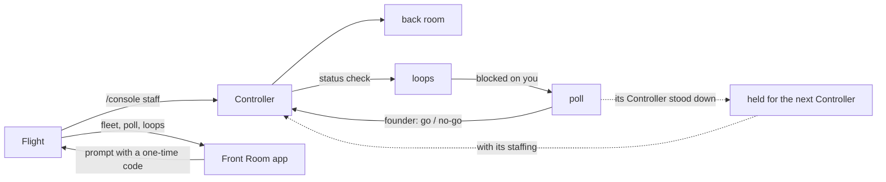

# Fleet

This skill is the guide to the `/console` commands. They belong to the
mission-fleet mod, so the skill carries a different name: a skill named
`console` would take `/console` from the mod, and a typed command could then
load this text instead of running.

The orchestrator session is **Flight**. Each **Controller** owns one front or
one project of a front, staffed on a **console** with a call sign. A
Controller's own sub-agents are its **back room**; messages between them are
the **loops**; whatever needs the founder lands in the **go/no-go poll**; the
**Mission Control App** is the Front Room (the console's own name for it).

## Commands (the console tool takes the same arguments, plus `--code <code>` when the app relays one)

| Command | What it does |
|---|---|
| `/console staff <front> [--project 
] [--model haiku\|sonnet\|opus\|fable] [--effort low\|medium\|high\|xhigh\|max] [--budget <n>] [--cwd <dir>]` | starts a Controller as the `mission-fleet:controller` agent type, in its scope's repo directory (or `--cwd`), with a staffing order naming the hub, spokes, progress log and back-room budget; `--budget` is a whole number from 0 to 20, default 4 |
| `/console list` | the fleet: state, the model its last request ran on, type, scope |
| `/console call <sign> <message>` | a message to one Controller, taken whole: words that start with two dashes and new lines reach it as written; its answer comes back as a status check |
| `/console retune <sign> <model\|-> [<effort>]` | changes model and effort from the Controller's next request |
| `/console poll` · `/console loops [<sign>]` | what waits on the founder; recent traffic |
| `/console go\|nogo\|no-go <id> [note]` | **the founder's alone**: typed, or relayed from the app with its one-time code; refused when Flight's model sends it on its own. The note is taken whole. For a Controller that has stood down, the decision is held for the next one under its call sign |
| `/console retry <id>` | **the founder's alone**: sends an undelivered go or no-go again to the Controller that raised it, while that Controller is still staffed |
| `/console dismiss-gate <id>` | **the founder's alone**: closes a poll item that no longer matters, or clears an undelivered or held decision; no verdict is sent to the Controller |
| `/console answer <n\|text>[ \| <n\|text>]` | **the founder's alone**: answers a question Flight sent to the app, from the Mac (an option number or free text, ` \| ` between several questions) |
| `/console stand-down <sign>` | asks the Controller for a dated handoff to the front's progress log and lists it stood down as soon as the request is delivered; the Controller writes the handoff, reports it and ends |
| `/console dismiss <sign>` | the end, nothing written (tests, or no work done) |
| `/console app [stop]` | **the founder's alone**: starts the Front Room on 127.0.0.1 and makes it a standing setting for this profile: it starts in every session of the profile, restarts after a plugin reload or a crash, and `/console app stop` stops it and turns the setting off |

## How Flight staffs

1. **Size it first** (Prime Directive 5): one line, `<n> Controllers x <model> x <effort>, back-room budget <b> each`, and the founder's go. The budget granted at staff time is the Controller's envelope for its back room; a spawn beyond it is refused by the mod and audited, and the Controller reports it as a blocker so the founder can grant more (restaff with a larger `--budget`).
2. **Cheapest model that holds the bar**, retuned on evidence: a Controller doing mechanical work runs on haiku; retune up when its reports show it struggling, down when the hard part is done.
3. **One console per scope.** A multi-project front gets one console per project that has work, or one front console that runs in the directory its projects share.
4. **Stand down when the work ends.** A console left staffed costs nothing while idle but its context grows; the progress log is its memory, so a new console starts cold without loss.
5. **Auto mode needs no switch.** The auto mode classifier gives no verdict on a call a plugin raises, so the fleet approves its own: a Controller spawn under a console name it is staffing, and a message to a staffed Controller. Settings rules and the other hooks still decide first; only the ask the mode cannot settle becomes an allow. Each approval leaves an `approve` line with the call sign in the fleet's audit log. A call to a fleet seat that the fleet does not approve, because it was raised outside the fleet's own loop or a rule beneath denied it, leaves an `approve-miss` line with the reason and is decided as usual.

## Flight's duties while consoles run

- **Route advisories.** A Controller's `contract:` line opens an advisory naming the fronts whose `_map.md` names its scope. On the founder's go it reaches the dependent consoles, or waits for them to be staffed.
- **Single writer.** Only Flight writes `_command/trackers/fronts.md`, `_command/daily/today.md` and `_command/fleet/`; Controllers propose, Flight writes.
- **The day's edges read the fleet.** `/briefing` and `/debrief` read each staffed console's last status (`/console list`, `/console loops <sign>`) and the open go/no-go items (`/console poll`), and put a Controller blocked on the founder first. `/standup` and `/retro` read git, the tracker and the boards only. Between them, use `/console list`, `/console poll` and `/console call <sign> <message>`.
- **Verify before relaying.** A Controller's state is only as fresh as its front's files; check a PR's real state (`gh pr view`) before reporting it to the founder.
- **Mark a message about Controllers.** When a message to the founder is about one or more Controllers, its first line is their call signs in bold, spelled as `/console list` shows them, on a line of their own and joined by a middle dot: `**MISSION-CONTROL**`, or `**<CALL-SIGN> · <CALL-SIGN>**` for several. The Front Room badges the message with each one in its Controller's colour, the colour it also wears on Consoles, Poll and Loops; the terminal shows the line as a bold header. A message in which Flight speaks for itself carries no marker. A name the fleet does not know, or a bold first word, stays text and badges nothing. The console tool's description carries the same rule.
- **Never answer a gate.** Go and no-go are typed by the founder or sent from the app; a prompt the app relays is the founder's decision, run as given (below).

## Decisions from the app

The Front Room never messages a Controller or starts one from its own loop,
which auto mode refuses. A tap, or a `/console` command typed in the app, that
would (`staff`, `call`, `go`, `nogo` or `no-go`, `retry`, `dismiss`,
`stand-down`) reaches Flight as a prompt in the founder's name:

    From the Mission Control App, the founder sent: go FI3 option 2
    Run it now with the console tool, args exactly: go FI3 option 2 --code <code>

- **Run it as given.** Call the console tool with exactly those args, the code
  included. The code is 32 hex characters, minted for those args, good for one
  try within 10 minutes, and kept in memory, so a plugin reload drops it. With
  it the call runs as the founder's own, which is how `go`, `nogo` and `retry`
  pass Flight's tool. A code that is unknown, used, expired or minted for other
  args is refused ("That app code is unknown, used or expired; send it again
  from the app.") and nothing runs; the founder sends it again from the app.
- **While it waits.** The engine documents that a submitted prompt runs as a
  turn of its own once the session is idle, so while Flight is mid-turn the
  prompt waits for that turn to end. A GO, NO-GO or Retry card says it was
  sent to Flight and runs once Flight is free, and takes no second tap (a
  repeat is answered "FI3 is already with Flight"); `/console poll` marks the
  gate "sent from the app, waiting for Flight". The hold ends when the
  decision runs, or 10 minutes after the tap, the code's lifetime: a decision
  whose code was refused, or whose prompt never reached Flight (the audit
  log's `app-op relay` line then says `not sent to Flight`), can be sent
  again only then. Staffing, calls, dismissals and stand-downs are not held.
- **Straight from the app**, as the founder and with no prompt: `dismiss-gate`,
  `retune` and `app stop`, and an answer to a question Flight asked.
- **Undelivered.** A decision its Controller did not receive stays on the Poll
  with the reason in one plain sentence and the engine's own words under
  "Technical details". While the Controller that raised it is still staffed,
  Retry sends it the same GO or NO-GO (`/console retry <id>`); a later
  Controller under that call sign never gets it. Dismiss
  (`/console dismiss-gate <id>`) clears it with nothing sent.
- **Held.** A GO or NO-GO for a Controller that has stood down is held, not
  sent: the next Controller staffed under that call sign receives it with its
  staffing, or at once if one is staffed now. Dismiss clears a held decision
  with nothing sent. The audit log reads `held <id> for <SIGN>`, then
  `held <id> delivered to <SIGN>`, or `held <id> NOT delivered to <SIGN>:
  <reason>` when the hand-over is refused and the decision turns undelivered.

The Poll lists, in order: open gates already sent to Flight, undelivered
decisions (one whose Retry is waiting says so on its card), the other open
gates, held decisions, then the last few decided and replaced. At the
terminal, `/console poll` lists the open items, the last three replaced, then
the undelivered and held decisions.

## Alerts and watches

A Controller's report that opens a **new** gate sends one fixed line to the
founder (desktop, or the phone while Remote Control is connected). A PR a
Controller names in its own `state:` or `shipped:` line is watched every ten
minutes; once its checks finish, a change in state, reviews, comments or check
results wakes that Controller to act and report. Merged or closed PRs and
stood-down consoles drop out of the watch.

## What the guard enforces, and what it does not

The mission-fleet guard refuses, for Controllers and their back rooms: unpinned git and gh calls (every call is `cd <repo> && git ...` or `git -C <repo> ...`), pushes to base or deploy branches, force pushes and deletions, stash, PR merges, writes to Flight's files, the Claude CLI, the app's port and other processes' environments. What a Controller may do inside its scope: commit, push its own feature branches and open PRs; it never merges a PR (`controller.ts`, `guards.ts`). In git, a back room may only read, add and commit. The guard is a text guard: it catches mistakes and steered agents, and it is **not a sandbox**. Base branches are held by server-side branch protection with administrators included (`framework/remote-access.md`).

A Controller may also clone any repository into any front of the portfolio:

- **Source**: a repository URL git fetches over the network, from any owner or
  host: `https://HOST/PATH` or `http://`, `ssh://[USER@]HOST[:PORT]/PATH` (or
  `git+ssh://`, `ssh+git://`), `git://HOST/PATH`, or `USER@HOST:PATH`. Refused by
  name: a remote helper (`HELPER::`, such as `ext::`), which runs a program; a
  `file://` or local-path source, which reads this Mac's folders, other fronts'
  repositories included; this Mac as the host (`localhost`, `*.localhost`,
  `127.x.x.x`, `0.x.x.x`) or a host written as a number other than `a.b.c.d`
  (`127.1` is `127.0.0.1`), which reads the same folders over ssh or reaches
  this Mac's own services; and a host or user starting with `-`, which ssh
  would take as an option. A name that resolves to this Mac by DNS is not
  caught: the guard reads text.
- **Where**: one level under a front's folder, `fronts/<front>/<repo>`, for any
  front with a hub under `_command/portfolio/` when the console was staffed, its
  own or another, whether or not that front's folder is itself a repository.
  `<repo>` is the folder git names for the URL, usually its last path part less
  `.git`, and never one starting with `.`, which tools read as their settings.
  The clone runs from exactly a front's folder
  (`cd <front folder> && git clone <source>`) or exactly the console's own
  directory with a destination one level under a front's folder (`../<repo>`
  from a repository there), named by its full path with no `..`, and with
  nothing but `-C <dir>` before `clone`. In the destination a `..` may only
  lead: after a folder name, it would step out through any link a cloned
  repository holds there. A destination that resolves anywhere else, a front's
  folder itself included, is refused, naming the command to use. A front's
  folder takes nothing but a clone.
- **Options**, by exact spelling only: `--depth N`, `--branch NAME` or `-b NAME`,
  `--single-branch`, `--no-single-branch`, `--filter=blob:none`, `--origin NAME`,
  `-q` or `--quiet`, `--no-tags`. Anything else is refused by name.
- **Literal words**: no variables, globs or substitutions.
- **Who**: any Controller, a project console included; its staffing order states
  the rule in one line. A console staffed before cloning was allowed is refused
  until it is stood down and staffed again, one staffed while a clone landed only
  in its own front still lands only there (from any source) until then, and a
  back room never clones.

## Remote

The Front Room on the founder's phone goes through `tailscale serve` only:
`framework/remote-access.md`.
