# Product flow

`/mission-flow` owns a ticket, `/epic-flow` owns an epic, and this skill owns
a product: the decisions above any epic, the order of the epics, and the four
moments where a human has to say yes because something becomes irreversible,
costs money, or reaches people.

```mermaid
flowchart LR
  I[idea + --budget] --> P0[0 Frame] --> P1[1 Discover] --> P2[2 Define] --> G1{{Gate 1<br/>the bet}}
  G1 --> P3[3 Design] --> P4[4 Architect + skeleton] --> P5[5 Release plan] --> G2{{Gate 2<br/>the blueprint}}
  G2 --> P6[6 Build<br/>epic-flow --auto per epic] --> P7[7 Verify] --> G3a{{Gate 3a<br/>deploy}}
  G3a --> P8[8 Beta] --> G3b{{Gate 3b<br/>go public}} --> P9[9 Launch]
  P9 -.->|weeks later, a separate run| P10[10 Learn]
```



## Invocation

```
/product-flow "<idea, vision or problem>" --budget <envelope> [--front <name>]
              [--platform web|mobile|both] [--thinking ...] [--verbosity ...]
/product-flow --resume <product-id>
/product-flow --learn <product-id>
```

- **`--budget`** is the spend envelope for the run, and it is the explicit go
  that fan-out needs (`framework/CONSTITUTION.md`, directive 5). Without it
  the run states its estimated envelope once, before Phase 1, and waits.
- **`--resume`** starts any later session from the product folder: it re-reads
  every phase document's `status:` and the gate records, never memory, and
  continues at the first phase not `complete`.
- **`--learn`** is Phase 10, run weeks after launch on the founder's word,
  because it reads production and production is read only on request.

## The product folder

Phase 0 creates the front with `/new-front` as a non-git front (its own
approval step applies), and the product folder beside its hub:
`_command/portfolio/<front>/product/`, laid out by `framework/task-board.md`.
It holds the brief, one document per phase with a `status: draft | complete
| superseded` header, the gate packs with their records, the research record,
and the spend ledger. Epic folders for Phase 6 live in the front's `tasks/`.
Templates: `framework/kit/templates/_product-brief.template.md` and
`_gate-pack.template.md`.

## The phases

Each phase's sub-phases, outputs and honesty rules live in its playbook under
`phases/`; this file owns the order, the gates and the grants.

| # | Phase | Playbook | Composes |
|---|---|---|---|
| 0 | Frame | `phases/01-frame-discover-define.md` | `/new-front` |
| 1 | Discover | same | research agents with web search |
| 2 | Define | same | - |
| 3 | Design | `phases/02-design-architect.md` | `/design-new` (stack-neutral tokens), `/design-review --mode proposal` |
| 4 | Architect and skeleton | same | `/adr`; the compliance block is drafted for the founder to run `/compliance-ref` |
| 5 | Release plan | `phases/03-plan-build-verify.md` | epic faces only, in each epic's folder |
| 6 | Build | same | `/epic-flow <key> --auto --decide minor` per epic, in release order |
| 7 | Verify | same | the flows' gauntlets, plus a release pass on staging |
| 8 | Beta | `phases/04-ship-beta-launch-learn.md` | - |
| 9 | Launch | same | launch surfaces are built as an epic in Phase 6, never with `/design-artifact` |
| 10 | Learn | same | `/triage`, `/retro` |

## The four gates

Gates sit where something becomes irreversible, costs money, or reaches
people, never at a phase boundary for its own sake. Each gate is one pack, one
decision, written from `_gate-pack.template.md`: the decision asked, the
evidence, the forks taken on the founder's behalf since the last gate with
the alternative for each, the kill-criteria check, the spend so far against
the envelope, the grants the gate gives, and the founder's actions in two
lists: needed now, and **start now**, for anything with a long lead time.

| Gate | After | The founder decides | It grants |
|---|---|---|---|
| **1 · The bet** | Define | positioning, MVP scope, the north-star metric, kill criteria; the value risk is shown as untested | Design and Architect; the proof may be published privately |
| **2 · The blueprint** | Release plan | identity, data model, stack, release plan with each epic's face | repo bootstrap and the skeleton commit; the cloud account and a staging spend cap; every epic run in release order, each face counting as that epic's E0 lock; merging epic PRs into the new repo's main until Gate 3a, because the skeleton makes deploy a separate act |
| **3a · Deploy** | Verify | the production deploy, live keys, alarm routing, the runbook | the deploy itself; beta invitations |
| **3b · Go public** | Beta | store submission, payments live, the announcement drafts the founder will send | the launch steps; nothing is posted on the founder's behalf |

3a and 3b merge into one gate when launch falls on deploy day.

## What stops a run, and what does not

**Before Gate 2, forks never stop.** Nothing is built yet, so each fork is
recorded with its options, the recommended branch is taken, and the fork goes
into the next gate pack, where the founder can overturn it at the cost of a
redraft, not a rebuild.

**After Gate 2,** the run stops only on epic-flow's list (a real fork failing
its rubric, a blocker, a red CI the one re-entry did not clear, an action
outside the grant), plus two of its own: a kill criterion tripped, and the
spend ledger crossing three quarters of the envelope. Nothing else is a stop:
not a phase ending, not an epic landing, not a summary, not the plan restated,
not a question the folder answers. Between epics the output is one line,
`LANDED EPIC <key> · <PR> · next <key>`.

## Honesty at product scale

Hard rules 1 and 6 apply to the product, not only to its code:

- Personas built from public evidence are **proto-personas**, labelled so.
- Market size is a sourced range or `[UNVERIFIED]`; every claim carries its
  source and retrieval date, and claims older than the run's TTL are
  re-checked before Gate 3a.
- Value and usability risk are **untested** until real people use the
  product; the bet is the founder's, never validated by the run.
- Legal text, pricing willingness and trademark clearance are drafts, marked
  as such, with the founder's action named.
- Gate 3a claims nothing for a risk that was not tested.

## Scope and the existing rules

- Research reads the public web only. Signing up for a competitor, running a
  survey, a fake-door page or a smoke test, and anything a site's terms
  forbid are founder actions in the gate pack.
- The run reads and writes only its own front. No other front is a
  reference, a template or a test bed.
- Production is read only on the founder's word in the moment, which is why
  Learn is a separate run.
- `/compliance-ref` is run by the founder; the flow drafts the block.
  `/design-artifact` is never called by the flow. `/new-front`'s approval
  step is honoured at Phase 0 and its repo binding at Gate 2.
- The tracker is the native board unless the founder names one; every epic
  and ticket is assigned and transitioned live (hard rule 10).

## Spend

A ledger in the product folder records each phase's dispatches by model and
effort, from the records `/spend` reads, against the envelope. Each phase
states its sizing before its first dispatch. Discover's research fans out
across agents with web search; build epics follow epic-flow's sizing.
