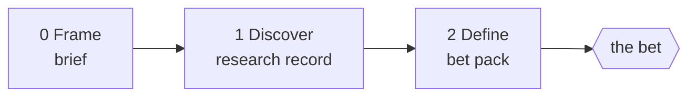

# Phases 0-2: Frame, Discover, Define

The phases before the bet gate. Nothing is built, so every fork is recorded, the
recommended branch is taken, and the fork goes into the bet pack.

## Phase 0 - Frame

**Output:** `product/brief.md` from `framework/kit/templates/_product-brief.template.md`.

1. Restate the idea as a problem, in the words of the person who has it.
   An idea that arrives as a solution gets its problem written first.
2. Who has it, who has it worst, how they cope today. The coping methods are
   the competitive alternatives, and doing nothing is always one.
3. The job to be done, the north-star metric, the launch bar.
4. Constraints and non-goals.
5. **Kill criteria**, at least three, each one checkable at a gate.
6. Create the front with `/new-front` as a non-git front; its approval step
   applies. The repo comes at the blueprint gate.

## Phase 1 - Discover

**Output:** `product/10-research.md`. Every claim carries its source URL and
the date it was read; a claim with neither is `[UNVERIFIED]`.

State the sizing before the first dispatch: research fans out across agents
with web search, one per question below, at the mid tier and low to medium
effort, with synthesis at the frontier tier.

| Question | What it produces | Honest limit |
|---|---|---|
| Alternatives | every way the job is done today: products, services, spreadsheets, doing nothing; their pricing, positioning, reviews and complaints | public pages only; no sign-ups |
| Market size | a range from more than one method, top-down and bottom-up, each with its sources | a single paywalled figure is `[UNVERIFIED]` |
| Pricing benchmarks | what the alternatives charge, how, and for which segment | listed prices, not what customers pay |
| Proto-personas | two or three, built from reviews, forums, job posts and public interviews, each quote linked | labelled proto-personas: no user was spoken to |
| The four risks | value, usability, feasibility, viability, each rated with its evidence | value and usability stay untested without real users |
| Privacy and regulation | the data the product would hold, where its users are, the rules that follow (consent, retention, deletion, residency, age, payments, sector rules) | a screen, not legal advice; the founder's legal action is named |
| Naming collision | whether the working name is taken in the market or the app stores | trademark clearance is a founder action |

A finding that trips a kill criterion goes to the top of the research record
and into the bet pack's recommendation.

## Phase 2 - Define

**Output:** `product/20-define.md` and the bet pack from
`framework/kit/templates/_gate-pack.template.md`.

1. **Positioning** (Dunford): the competitive alternatives, the unique
   attributes, the value they enable, the customers who care most, the
   market category. One positioning statement.
2. **Business model and pricing:** who pays, how, how much, and the unit
   economics the price implies, to be re-checked at the blueprint gate against the cost
   model.
3. **MVP scope** from a story map: the backbone of activities, the walking
   skeleton across it, and the first release's slice. Everything below the
   slice is a non-goal for now.
4. **Analytics:** the north-star metric decomposed into the events that
   measure it, named now so the build instruments them and Learn has data.
5. **Locales and direction:** the languages, right-to-left or not, digit and
   date conventions. The design's state matrix needs this answered.
6. **The bet pack:** positioning, scope, metric, kill criteria, what is still
   untested, forks taken, spend, and the founder actions: needed now, and
   start now (store developer enrollment, a business entity, domains,
   trademark clearance).

**The bet gate.** On a yes, the run continues to Design. On a no, the
pack's recommendation names what would have to change, and the run stops.
