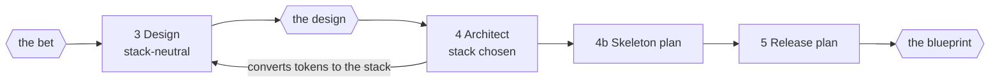

# Phases 3-4: Design, Architect and skeleton

Between the bet gate and the blueprint gate, with the design gate in the middle. Still nothing is built in a repo, so forks are
still recorded and taken; they reach the founder in the blueprint pack.

## Phase 3 - Design

Run `/design-new --front <front> --stack-neutral --local` in full mode: the
stack is chosen in Architect, so tokens are DTCG only and the foundation is a
requirement, and the proof stays on the founder's machine.

1. Information architecture and the key flows, from the story map's slice.
2. Identity and its deciding sentence, from the positioning.
3. Comps of the key screens, each with its six-state row, honouring the
   locales and direction from Define.
4. Content: the voice, naming of the product and its parts, the words on
   every primary action, every error and every empty state.
5. The clickable proof, kept local: the bet gate approved the bet, not an
   upload. It may be published privately when the founder asks.
6. `/design-new`'s own review of the proof is the design review; the run
   does not repeat it.

**The design pack:** the identity and its deciding sentence, the key screens
in every state of their matrix, the proof (local, opened on the founder's
machine), the review's findings and what was fixed, the forks taken since the
bet, and what is still unvalidated with real users.

**The design gate.** The founder reviews the designed product. A yes lets
Architect build on it; named changes are made, then the run continues
without asking again; a no returns the run to Design with the reasons.

## Phase 4 - Architect

Each decision is an ADR (`/adr`) in the front, with the alternatives
rejected and why.

1. **Stack**, against the platform, the team that will maintain it, the
   hosting it implies and its cost. Then convert the design's tokens to the
   stack's format and name the component foundation package.
2. **System boundaries** and their contracts.
3. **The data model**, with the privacy rules from Discover built in:
   what is stored, where, for how long, how it is deleted, what consent
   covers. This is the model the blueprint gate approves; migrations that implement it
   are settled work in Phase 6, and a departure from it is a fork.
4. **Threat model**: assets, entry points, the likely attacks, the controls.
5. **Compliance**: where the product answers to a standard, the profile
   block is drafted; the founder runs `/compliance-ref`.
6. **Infra and cost model**: environments, hosting, third-party services,
   the monthly cost at launch and at ten times the launch bar. Re-check the
   unit economics against Define's price; failing them is a kill criterion.

## Phase 4b - The walking skeleton

The skeleton is planned here and built as the first epic after the blueprint gate. It is
the thinnest slice through every boundary that proves the product can run in
production, before any feature is built on it.

- A repo with CI, the test gauntlet and the leak guard wired.
- Environments: local, staging, production; staging is real, so Phase 7 can
  test against it.
- **Deploy as a separate act**: a tag or a manual workflow, never a merge to
  main. A merged epic then never deploys by accident.
- Observability from the first request: logs, metrics, the alarms and where
  they route.
- Backups with a restore that has been run once.
- Secrets management, transactional email with its sending domain, and
  versioning for releases.

## Phase 5 - Release plan

The epics of the first release, in order, the skeleton first and the riskiest
interface next. Each epic gets only its face, in its own folder in the front's
`tasks/`: outcome, non-goals, the terminal assertion. Their fragments are
planned by `/epic-flow` when each one runs, against the code the epics before
it wrote. Typical epics beyond the features: accounts with deletion, billing
with tax and refunds, admin and support tooling, the landing page and store
listings, onboarding, help docs, analytics instrumentation.

**The blueprint pack**: identity, data model, stack, release plan and faces,
the forks taken since the bet gate, the cost model and unit economics against the
kill criteria, spend, and what a yes grants (see the skill's gate table).
Founder actions: needed now (the cloud account, the repo's home), start now
(payments in test mode, the sending domain).

**The blueprint gate.** A yes locks every face and starts Phase 6.
