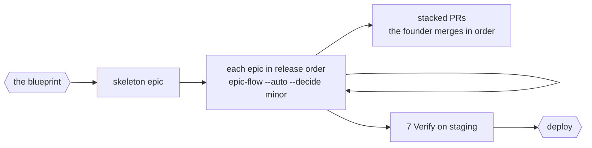

# Phases 6-7: Build and Verify

After the blueprint gate. The blueprint is locked; the run builds it and proves it on
staging, stopping only on the list in the skill.

## Phase 6 - Build

1. **Bootstrap the repo** under the blueprint gate grant: create it in the home the
   founder named, commit the skeleton, bind it to the front's spoke
   (`/new-front`'s repo binding), record the base branch, wire CI.
2. **Each epic, in release order:** `/epic-flow <key> --auto --decide minor`.
   Its face, locked at the blueprint gate, counts as its E0 lock, so it plans E1 to E6
   against the code the earlier epics wrote and runs without re-asking.
   Every child is a full `/mission-flow`, with its design steps for
   UI-shaped work.
3. **Stack, never wait.** The first epic branches from the repo's main; each
   later epic branches from the one before it (`--base <previous epic branch>`)
   and opens its PR against that branch. The founder merges the PRs in order,
   whenever they choose; the next epic is already building on top.
   - When a lower PR merges, GitHub moves the next PR's base to main. If it
     merged as a squash, merge main into the next epic's branch - merge,
     never rebase - and prove the merged tree equals the branch's tree before
     continuing.
   - Each epic's children move to done when the founder merges its PR,
     which is epic-flow's own batch transition, unchanged.
   - Deploy stays a separate act, so a merge to main changes no live system.
4. Between epics: one line, `LANDED EPIC <key> · <PR> · next <key>`, the
   spend ledger updated, the kill criteria re-checked against what was
   learned while building.

A migration that implements the data model the blueprint gate approved is settled work.
A change to that model is a fork, and after the blueprint gate a fork stops the epic and
goes to the founder.

## Phase 7 - Verify

The release pass, on staging, over the whole product rather than one ticket:

- **End to end:** every flow in the MVP slice, in every state of its matrix,
  driven in a real browser or device.
- **Performance:** the budgets the front's DESIGN.md quality bar declares.
- **Accessibility:** axe on every view, and a keyboard-only pass of every
  primary flow.
- **Security:** an automated scan and the threat model's controls checked
  one by one. A penetration test by a person is a founder action, listed.
- **Load:** the launch bar times ten against staging, within the staging
  spend cap.
- **Acceptance script:** the brief's job to be done, walked step by step.
- **Restore drill and rollback rehearsal**, both on staging.
- **Research refresh:** claims older than the brief's TTL are re-checked;
  a change that trips a kill criterion goes to the top of the deploy pack.

**The deploy pack:** the release evidence, every test that was not run and
why, live keys and alarm routing needed, the runbook, the rollback plan.
The deploy gate claims nothing for a risk that was not tested.

**The deploy gate.** A yes grants the production deploy and the beta
invitations.
