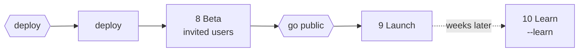

# Phases 8-10: Ship and beta, Launch, Learn

From the deploy gate to the first measured result. Everything here reaches
real people or real money, so the gates carry it and nothing is sent on the
founder's behalf.

## Phase 8 - Deploy and beta

1. **Deploy** by the skeleton's separate act, under the deploy gate grant. Read
   back what is live (the health endpoint's release identifier, not the
   deploy job's colour) before calling it deployed.
2. **Watch the first hour:** alarms quiet, error rate and latency within
   budget, one real request traced end to end.
3. **Beta:** the internal and store test tracks, and invitations the founder
   sends or approves sending. Real users make this production: their data is
   read only on the founder's word, and never used as test data.
4. **Feedback triage:** every report goes to `/triage` with its source;
   anything that trips a kill criterion goes to the top of the go-public
   pack.

**The go-public pack:** beta findings and what was fixed, store review
readiness (account deletion, privacy labels, screenshots), payments moving
from test to live, the announcement drafts, the support channel, and what
is still untested.

**The go-public gate.** It merges into the deploy gate when launch falls on deploy
day.

## Phase 9 - Launch

Under the go-public gate grant:

- Store submission, and the review loop: a rejection is read, fixed in a
  ticket, and resubmitted.
- Payments switched to live, one real transaction verified end to end.
- The landing page, listings and help docs, built as epics in Phase 6, made
  public.
- Announcements: drafted for each channel and handed to the founder, who
  posts them. Nothing is posted on the founder's behalf.
- Support: the channel, the response target, and the first-hour watch
  repeated for the public launch.

The brief's `gates.go_public` is filed with the date, and the hub's status
says the product is live.

## Phase 10 - Learn (`/product-flow --learn <id>`)

A separate run, weeks after launch, invoked by the founder, because it reads
production and production is read only on request. `/retro` suggests it once
the launch bar's window has passed.

1. The north-star metric and the launch bar from the brief, against what the
   analytics events actually recorded. A number that cannot be computed
   because an event was never instrumented is a finding, not a gap to
   estimate around.
2. Each kill criterion, checked. One tripped is a recommendation to stop or
   to change the bet, written plainly.
3. Feedback and support themes, sent to `/triage` as candidates.
4. What the product taught the method, through `/learn-from-session`.
5. The next release: a new release plan, which returns the run to Phase 5
   and to a new blueprint gate for anything that changes the data model,
   the identity or the stack.
