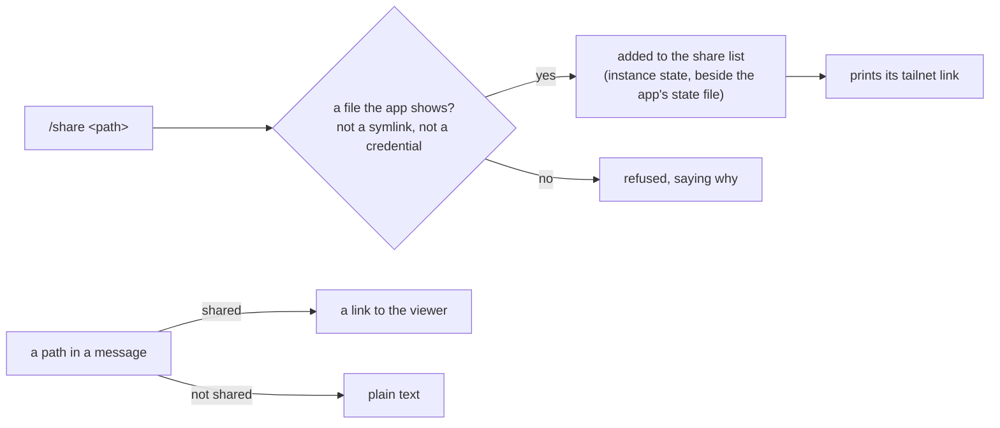

# Share



The app shows a file only when it is on the share list. A path in a message
links only when that file is shared; any other path stays plain text. Sharing
is the founder's or Flight's: the fleet guard refuses the script to every
Controller and back-room agent, which leave a file to share under
`for you to do:` instead.

## Run it

From the portfolio's root:

```
node tools/app/share.mjs <absolute path>      # share it and print its link
node tools/app/share.mjs --list               # every shared file
node tools/app/share.mjs --revoke <path>      # stop sharing it
```

Pass the arguments exactly as the founder gave them (`/share --list` runs
`--list`). Paste the script's output to the founder as it printed it, the link
included. When the founder names a file by a description rather than a path,
find its absolute path first and say which file it is before sharing it.

## What it refuses

- A path that is not absolute, or holds `..`.
- A symlink (share the file it points to), a folder, or a missing file.
- A type the app does not show (it shows Markdown, text, JSON, CSV, YAML,
  logs, diffs, HTML, images and PDF), or a file over 25 MB.
- Anything that may hold a credential: a file in a `.git`, `node_modules`,
  `secrets`, `.aws`, `.ssh`, `.gnupg`, `.config`, `gcloud`, `launch` or
  `credentials` folder; a dotenv, key, certificate, service-account, Firebase
  admin key or Terraform variable or state file; a data file (`.json`, `.txt`,
  `.yml`, `.yaml`, `.log`, `.csv`) whose name holds key, secret, token,
  credential, passw or private. The server applies the same rules again, so a
  credential added to the list by hand is still not served.

## What sharing means

- The list holds each file's real path. The server shows the file at that
  path as it is now (a report updated after sharing shows the update).
- A shared file that moved is not shown at its new place; share it again.
  A shared path that now resolves somewhere else (a symlink put in its place)
  is not shown.
- The link opens the app's viewer in a new tab. It needs the founder's tailnet
  sign-in or the app token, like the rest of the app; a PDF or an HTML report
  opens through a single-use ticket and is served sandboxed.
- Revoking takes effect on the next request; nothing needs restarting.
