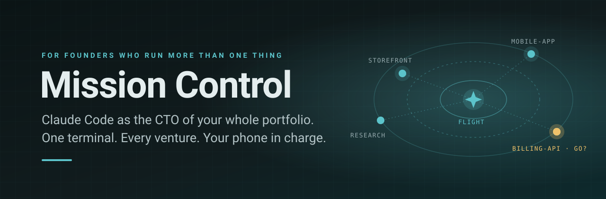
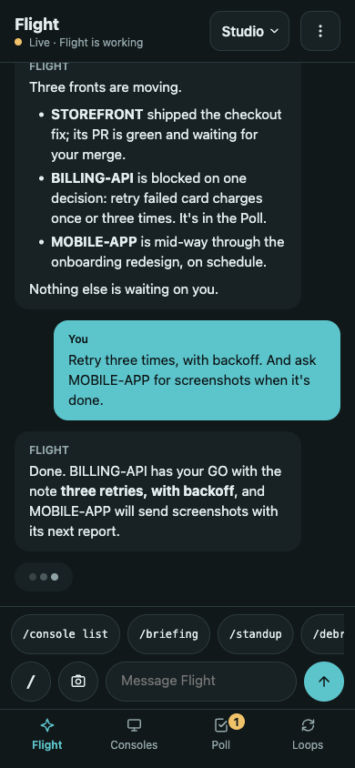
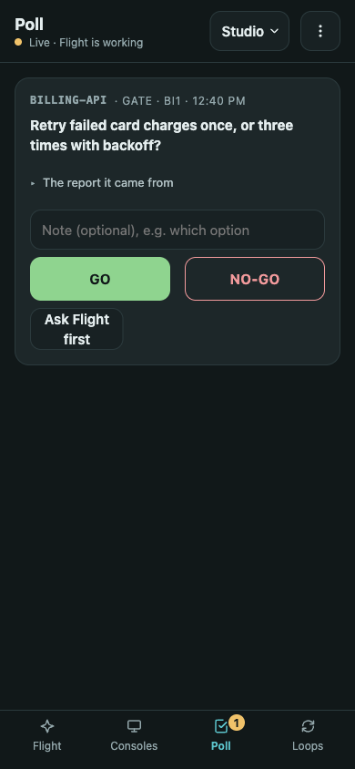
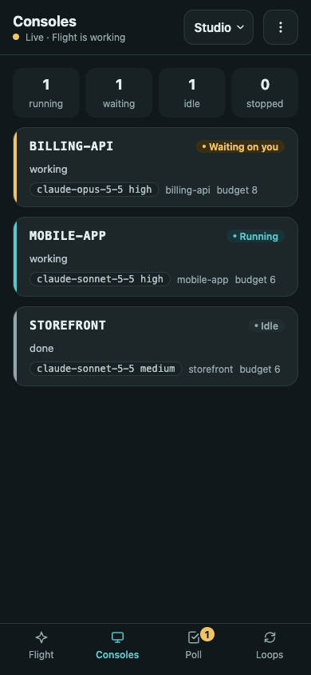
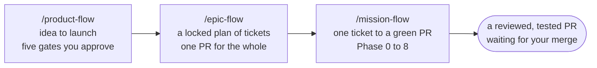
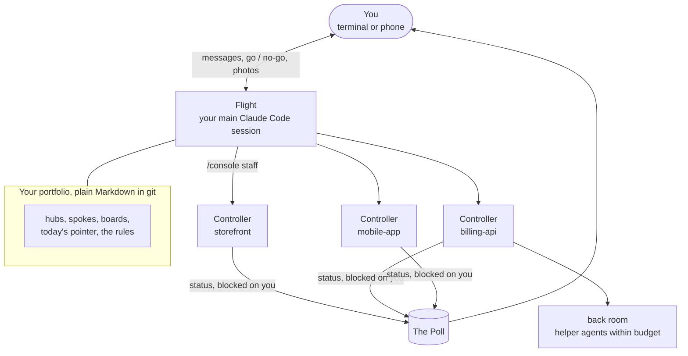
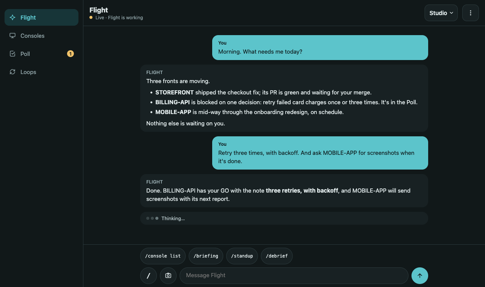

<p align="center">
  
</p>

<p align="center">
  <b>The operating system for founders who run more than one thing.</b><br>
  Claude Code runs your portfolio like a CTO would: plans before it spends, asks before it ships,<br>
  remembers every project, and puts every decision that needs you one tap away on your phone.
</p>

<p align="center">
  
  
  
  
</p>

---

You have a product that pays the bills, a side venture, a partner project and a day job.
Claude Code is brilliant at any one of them for an afternoon. Across all of them, for months,
it forgets what it was doing, spends what it should not, and asks you the same questions
again. Mission Control is the missing layer: a portfolio memory, a set of rules it cannot
argue its way around, and a control room you can run from your phone.

<p align="center">
  
  &nbsp;
  
  &nbsp;
  
</p>
<p align="center"><sub>The Mission Control App on a phone: Flight's morning summary, the decisions waiting on you, and the Controller running each front.</sub></p>

## What it does for you

###  Run every venture at once, from one terminal

Your main Claude Code session becomes **Flight**, and it staffs a **Controller** for each
venture: a long-lived agent that works that one front, keeps its own back room of helpers
within a budget you set, and reports in four lines (state, shipped, blocked on you, next), plus a fifth when something other fronts depend on has changed.
Change a Controller's model mid-job, call it, or stand it down with a written handoff.
PR watches wake a Controller when its checks or reviews change, so nobody polls GitHub.

###  Every decision that needs you, in one place

When a Controller is blocked on something only you can decide, it lands in the **Poll** as a
go or no-go, with the report it came from. Answer with one tap and a note. Changes that ripple
into other fronts are routed to the Controllers they affect. Nothing waits silently.

###  Run it from your phone, from anywhere

`/console app` starts the **Mission Control App**: Flight's conversation, your Controllers,
the Poll and the message traffic, as a home-screen app. Over Tailscale it reaches your phone
in any city, signed in by your own Tailscale account and never exposed to the public internet.
Send Flight a message or a photo, answer the questions it asks, get an alert when a decision
lands. One front door covers every Claude account you use (work, personal, a partner's) with
a switcher in the header. Once on, it keeps itself running for as long as your session does.

###  Guardrails it cannot talk its way around

It never commits, pushes, deploys or spends without your word in the moment. Fan-outs of
agents are sized and approved before they fire, every agent gets the cheapest model and
effort that holds the bar, and evidence comes before every claim. Controllers may push their
own feature branches and open PRs, never merge, never touch a base or deploy branch, and a
guard enforces that on every tool call. Hooks block personal data and process chatter from
ever reaching a commit or a PR.

###  Delivery at the right altitude

One ticket, one epic or a whole product, each with the same standards inherited all the way
down:



`/mission-flow` takes a bug or a task to a checks-green PR: root cause before fix, tests at
the altitude of the risk, review by right-sized agents, the real app run before anything is
called done. `/epic-flow` plans work bigger than one ticket into a tree you lock, then runs
each piece as a full mission-flow. `/product-flow` takes an idea through framing, research,
design, architecture, build, deploy, beta and launch, and stops at the five moments where a
human has to say yes.

### It remembers, and it gets sharper

Every front gets a hub, every repo a spoke with its gotchas, every day a single pointer to
what matters. Resume any project with no re-briefing. Each session's lessons pass an
eight-rule critique into a learning log, and the ones that keep proving true are promoted,
with your sign-off, into standing rules that load every session. It ships with a seed corpus
of 23 lessons paid for on a real multi-venture portfolio.

## How it works



Everything is local and yours: plain Markdown files in a git repository, the rules Claude
loads every session, and 26 skills that turn your rituals into one command each. No hosted
service, no database, no lock-in.

<p align="center">
  
</p>

## Start in 60 seconds

```bash
git clone https://github.com/<owner>/mission-control my-portfolio
cd my-portfolio && claude
> hi
```

That is the whole install. Your first message starts **LIFTOFF**, a guided session (about
4 to 6 minutes per project, three approval gates) that interviews you, scans your real repos
instead of quizzing you about them, and stands up your portfolio. It ends with a proof: a fresh
session reads your setup cold, states your board and your rules, and **refuses an
unauthorized push**. That refusal is the product working. Big portfolio? Lift off with the
fronts you touch this week and add the rest later with `/new-front`.

Then, for the phone: load the mission-fleet plugin (see [tools/README.md](tools/README.md)),
type `/console app`, and follow [the remote access guide](framework/remote-access.md).

## A day with Mission Control

| When | You type | What happens |
|---|---|---|
| Morning | `/briefing` | It reads every front and locks today's one objective |
| Any time | `/console staff <front>` | A Controller takes a venture and runs it |
| A bug or a task | `/mission-flow <description>` | Root cause to a checks-green PR, nothing merged without you |
| Bigger work | `/epic-flow` or `/product-flow` | A plan you lock, then the whole thing delivered |
| Before a meeting | `/standup` | A paste-ready report with a two-minute talk track |
| Evening | `/debrief` | Progress written, lessons captured, tomorrow's pointer set |

All 26 skills, grouped by what they are for: [.claude/skills/README.md](.claude/skills/README.md).

## What it is not

- **Not an autonomous coder you leave alone.** It presents, you decide. Every irreversible or
  outward-facing step stops for you, from your phone if you are away.
- **Not a hosted product.** It runs in your Claude Code, on your machine, in your files.
- **Not a prompt pack.** The rules are enforced by hooks and guards, not just written down.

## Keeping it up to date

Keep this repository as `upstream` and your portfolio on a private `origin`:

```bash
git remote rename origin upstream
git remote add origin <your-private-repo-url>
git pull upstream main    # updates framework/, .claude/skills/ and tools/; your _command/ never collides
```

Read the new entries in [CHANGELOG.md](CHANGELOG.md) after each pull: doctrine changes never
reach you silently. Run `git config merge.ours.driver true` once so the shipped
`.gitattributes` keeps your own `CLAUDE.md` over the bootstrap on every pull. Your instance
(`_command/`) is gitignored and never travels here; keep it in a private repository of your
own if you want its history.

## Requirements

- **Claude Code** with plugin support. The console fleet is a Claude Code plugin
  (`tools/mods/mission-fleet`).
- **Node.js** for the Mission Control App and the docs viewer.
- **Tailscale** (optional) to reach the app from your phone.
- **macOS or Linux** is the primary platform: every gate has a bash form. On Windows the leak gates and the reference check also ship as
  PowerShell; a few newer tools are bash only.
- **The superpowers plugin** (recommended): the doctrine uses its brainstorming, test-driven
  development and systematic debugging disciplines, and falls back to the written versions in
  `framework/` without it.

## Under the hood

| Folder | What lives there |
|---|---|
| [framework/](framework/CONSTITUTION.md) | The doctrine: the constitution, the engineering standard, routing, continuity, design, remote access |
| [.claude/skills/](.claude/skills/README.md) | The 26 skills |
| [tools/](tools/README.md) | The gates and hooks, the mission-fleet plugin and the Mission Control App |
| [LIFTOFF.md](LIFTOFF.md) | The one-time guided setup |

## Provenance and license

Mission Control joins two lineages proven on a real multi-venture portfolio: a governance kit
(gate-locked phases, evidence before claims, deviation registers) and an orchestration method
(agent routing, context isolation, the learning loop). The seed lessons in
`framework/learning-seed/` are that portfolio's real corpus, de-personalized, and the leak
gates keep it that way on every publish.

**License: PolyForm Noncommercial 1.0.0**, see [LICENSE](LICENSE). Free for personal and
noncommercial use. Commercial use of the software itself (reselling it, hosting it as a
service, or building commercial products on it) is not granted; a commercial offering is
planned by the author. For commercial licensing, open an issue on this repository.
