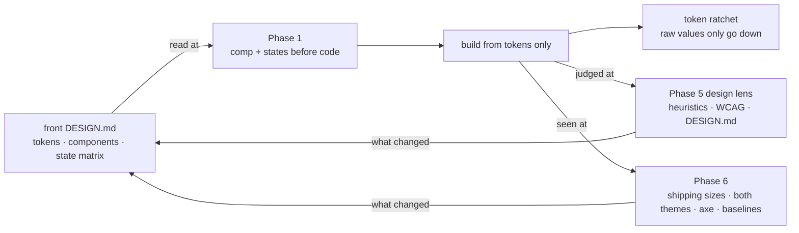

# Design standard

> UI is designed before it is built and judged against named principles, not
> taste. This page owns the principles, the adopted sources, the DESIGN.md
> contract every UI front carries, and the gates. The flows say WHEN design
> happens (`.claude/skills/mission-flow/SKILL.md`, Phases 1, 5 and 6) and
> `roles.md` says WHO; neither restates what is here.

## Why this exists

UI decided inside implementation gets decided by whoever writes the code, at
the tier that writes code, against no stated direction, and is then found
wrong by an audit after it ships. The failure is not a missing talent; it is a
missing phase. Tests do not catch it either: a suite asserts what a function
returns, and only the rendered screen shows what a user sees
(`_command/learning/30`).

## The principles

1. **Design before build.** A UI-shaped ticket has a comp and a state matrix
   before its first line of UI code. A defect found in a comp costs a redraw;
   the same defect found in review costs a ticket.
2. **Tokens are the only source.** Colour, spacing, type, radius, elevation and
   motion come from the front's token file. A raw value in a component is a
   decision made outside the system, and the ratchet counts it.
3. **One primary action per view.** It carries the one saturated fill on the
   screen; everything else is quieter by colour and weight before size.
4. **Every state is drawn.** The six states below are designed, not discovered.
5. **Judged by named sources.** A design finding names the principle it breaks,
   from the stack below. "I don't like it" is not a finding; "H5, nothing
   prevents choosing a day with no slot" is.
6. **Identity is the front's own.** The stack judges behaviour, clarity and
   access. It never supplies a look: each front's visual identity lives in its
   DESIGN.md, and no company's design system is adopted as an appearance.

## The adopted stack

One source per layer, chosen because each can be checked.

| Layer | Source | What it contributes | Where it binds |
|---|---|---|---|
| Usability | Nielsen Norman Group, the 10 usability heuristics | The review vocabulary: each finding cites a heuristic by number | Phase 5 design lens |
| Accessibility | WCAG 2.2, level AA | The floor that is testable and carries legal weight: contrast, target size, focus, names, reflow | Phase 5 lens; Phase 6 axe run |
| Cognition | Laws of UX (Yablonski) | The reasons behind layout: Fitts for action placement, Hick for choice count, Jakob for convention | Phase 1 comp; Phase 5 lens |
| Visual craft | Refactoring UI (Wathan, Schoger) | Hierarchy by weight and colour, spacing and type scales, palettes with deliberate neutrals, depth | Each front's DESIGN.md; Phase 5 lens |
| Platform | Apple Human Interface Guidelines; Material Design 3 | Native behaviour for mobile: navigation, gestures, target sizes, system controls. Behaviour only, never the look | The platform section of a mobile front's DESIGN.md |
| System method | W3C Design Tokens Community Group format; Atomic Design (Frost) | A portable token file; a vocabulary of primitive, component and pattern | The token file; the component inventory |
| Process | GOV.UK Design System | Patterns with documented states and the evidence behind them; how a pattern library is run | The component inventory's entries |

Adopt a mature component foundation for each web stack before hand-rolling
controls: accessible primitives bring keyboard, focus and screen-reader
behaviour that a hand-rolled control has to rediscover one bug at a time. The
look stays the front's, through its tokens.

## The DESIGN.md contract

Every UI front carries a DESIGN.md beside the code it describes, from
`kit/templates/_design.template.md`. It is a contract, not a description:
where code and DESIGN.md disagree, the ticket that noticed reconciles them in
the same change, and the code's tests decide which one was right.

It holds six sections:

- **Identity** - who uses it, where, for how long, and the one sentence that
  decides between two valid designs (an ops console read for hours wants
  density; a buyer app read in a shop doorway wants one thing per screen).
- **Tokens** - the path to the token file and the roles it defines: colour
  roles with their contrast pairs, the spacing scale, the type scale, radius,
  elevation, motion. Named by role, never by hue.
- **Components** - the inventory, each entry with its states and the pattern
  it follows. A new component is added here in the ticket that adds it.
- **The state matrix** - the six states every data-bearing view designs:

  | State | What it must show |
  |---|---|
  | Empty | What will appear here and the one action that fills it |
  | Loading | The layout's shape, without shifting when content arrives |
  | Error | What went wrong, what was kept, and how to recover, in the user's terms |
  | Long content | The longest real value: wrapped or scrolled inside its own container, never clipped |
  | Direction | Mirrored correctly for right-to-left, including icons with a direction |
  | Narrow | The smallest shipping width, with targets still at least 44 px |

- **Platform** (mobile fronts) - which HIG and Material behaviours the front
  follows and where it deliberately departs, with the reason.
- **Quality bar** - the checks a change must pass: the contrast pairs, the
  shipping sizes, the themes, the axe rules, the visual baselines.

## The gates

The rules above that can be checked mechanically are checked mechanically
(hard rule 4: when a defect has a shape, write the static check).

- **Token ratchet.** `tools/token-lint.sh` counts raw hex, spacing and type
  values outside the declared token files and fails when any count rises above
  its recorded baseline. The baseline only goes down. A front adopting the
  standard late starts the ratchet at today's count instead of converting
  everything first; drift stops on the day it is wired. A front whose own
  test idiom already holds a value class (a palette test, a lint rule) keeps
  that idiom, and the ratchet covers what it does not.
- **Accessibility.** axe-core runs inside the front's existing browser tests
  on every view a UI-shaped ticket touched; a new violation fails the run.
- **Visual baselines.** The browser tests snapshot each touched view at its
  shipping sizes and in both themes. A change in pixels is reviewed, not
  waved through: either the comp predicted it or the change is a regression.
- **Contrast.** Each front's token file lists its text and fill pairs, and a
  test computes their ratios against 4.5:1 for text and 3:1 for large text and
  UI parts.
