# Engineering Standard - the 13 SDLC layers

> The standard the AI CTO holds at every layer of every project, regardless of front. This is the generic half of the mental model; the personal half (who the founder is, the fronts) lives in your instance at `_command/mental-model.md`, written at liftoff from `kit/templates/_mental-model.template.md`.

```mermaid
flowchart LR
  subgraph DISC["DISCOVER"]
    L1["1 · Product & Requirements"]
    L2["2 · Research & Validation"]
  end
  subgraph DESN["DESIGN"]
    L3["3 · UX"]
    L4["4 · UI & Design System"]
    L5["5 · Architecture & API"]
    L6["6 · Data & Database"]
  end
  subgraph BLD["BUILD"]
    L7["7 · Frontend"]
    L8["8 · Backend"]
    L9["9 · Security & Compliance"]
    L10["10 · Testing & QA"]
  end
  subgraph RUN["SHIP & RUN"]
    L11["11 · CI/CD · Deploy · Infra"]
    L12["12 · Observability"]
    L13["13 · Docs · ADRs · Tech-debt"]
  end
  DISC --> DESN --> BLD --> RUN
  CC["cross-cutting on EVERY layer - git hard-rule · evidence-before-claims · gate-locked · implement-exactly · diagram-first · right-sized agents · real-evidence-only"]
  CC -.-> DISC
```

| # | Layer | The standard we hold |
|---|---|---|
| 1 | Product & Requirements | vision to roadmap to epics to stories; acceptance criteria that name their own evidence type (a test, a command's output, a `file:line`, or runtime) + definition of done |
| 2 | Research & Validation | real-evidence-only; cited sources; no invented personas or claims |
| 3 | UX | documented flows + wireframes; accessibility contract |
| 4 | UI & Design System | tokens + components + brand; no one-off styling |
| 5 | Architecture & API | system design + explicit contracts/interfaces; clear boundaries; an optional tool is a boundary with a tested absent path ([Optional augmentation](#optional-augmentation)) |
| 6 | Data & Database | modeled schema; migrations; integrity + idempotency |
| 7 | Frontend | implement-exactly; perf budgets (e.g. Core Web Vitals on web) |
| 8 | Backend | services, jobs, queues; perf- and cost-accounted |
| 9 | Security & Compliance | authn/z, secrets in gitignored `.env`, privacy/RLS, least-privilege |
| 10 | Testing & QA | test-plan-before-code; coverage; founder live-QA sign-off |
| 11 | CI/CD · Deploy · Infra | reproducible pipelines + environments; **git workflow** lives here |
| 12 | Observability | logging, metrics, alerts, incident tracking |
| 13 | Docs · ADRs · Tech-debt | docs-as-pictures; decision records; tracked (never silent) debt |

**Cross-cutting on every layer:** git hard-rule · evidence-before-claims (literal output) · gate-locked · implement-exactly · diagram-first · right-sized agents · real-evidence-only. **Performance & cost** ride layers 7/8/12; **git-workflow** rides 11.

## Definition of Done - the integration-truth floor

The generic floor a change clears before it is `done`. The ticket template
(`kit/templates/_task.template.md`) instantiates this as a per-ticket checklist,
and `task-board.md` enforces it; an instance may bind a sharper version in
`_command/CONSTITUTION.local.md`. "Compiles + unit-green" is a checkpoint, never
done.

1. **Real path, end to end** - no stub or mock on the critical path; every
   external boundary gets one live integration pass against a non-production
   instance or a downloaded copy, never a production system; a remaining stub is
   `[STUB]` and the ticket stays open.
2. **Reachability proven** - each new service, handler, job or provider is
   obtained the way production obtains it in at least one test (the container,
   the route, the event, the scheduler), never only constructed; every value the
   code reads has a named writer in the deployed environment; any string a remote
   service parses was executed against that service. Code that nothing calls
   passes every test it has.
3. **Whole vertical slice** - both sides wired and verified against the
   acceptance criteria, proven by at least one test exercising the actual
   serialized request across the boundary (not two mocks of the same idea),
   plus request validation so a contract violation is a clean 4xx, not a 500.
4. **Production-execution reality** - how the change runs in the DEPLOYED
   environment is established at design time, not after review: reachability,
   where jobs/migrations run, the secrets/roles/deploy hooks it relies on. A
   bulk or one-off data change runs inside the deployed system, never from a
   laptop. A thing that works locally but cannot run in prod is a planning
   defect.
5. **Terminal artifact verified** - query the thing the user consumes, broken
   down by the unit that can partially fail; a green checkpoint is a promise,
   not a receipt. **The command that proves it is DECLARED when the ticket is
   written, not chosen after the implementation exists** - choosing the proof
   once the code is in front of you invites choosing one that passes. A better
   assertion found later is adopted as a logged deviation, never a silent swap.
6. **Designed for scale** - bulk semantics, idempotency, backpressure; N rows is
   one bulk call plus a queue, never N requests.
7. **Tested at the altitude of the risk** - user-critical flows get e2e; unit is
   the floor, never the ceiling; the plan names the altitude and why. At least
   one new assertion is proven able to fail: break what it guards, see red,
   restore, and the red output names the targeted assertion.
8. **Designed before built (UI-shaped tickets)** - the front's DESIGN.md read
   first; a comp and the six-state matrix row exist before the first UI commit;
   rendered views match them; no new raw value outside the token files. N/A with
   a reason for a ticket that changes nothing a user sees.
9. **No guess worn as a finding** - root cause shown with literal evidence;
   assumptions labelled `[ASSUMPTION]` / `[UNVERIFIED]`; the outward artifacts
   (commit, PR, tracker, docs) read as an engineer authored them, zero process
   vocabulary.

The full wording of each item is in the template, which is the single source.

## Optional augmentation

A tool a skill or a check can do without (a diagram renderer, a browser
driver, an audit command one front lacks) is an optional augmentation. It
binds this product's own skills and tools; in a partnered repository it is
advisory, as the rest of this standard is. Four rules, each one checkable:

1. **Removable.** The primary path completes without the tool. Its absence
   takes a capability away; it never fails the run.
2. **Declared.** Each optional tool is named in one place for its project,
   with what is lost without it: a skill's own text, or the repository's
   spoke for a front. An optional tool named nowhere is a hidden
   requirement.
3. **One named line, not silence and not prose.** When the tool is absent
   the run prints one line in a fixed shape,
   `DEGRADED: <tool> unavailable - <what was skipped>`, for example
   `DEGRADED: mmdc unavailable - mermaid blocks served as source`. A fixed
   prefix is what a check can assert and a reader can grep; prose can only
   be read.
4. **The absent path is tested.** A check runs the flow with the tool
   absent and asserts both that the primary path completed and that the
   named line appeared, and runs it once with the tool present, so a check
   that never found the tool cannot pass as one that masked it. An untested
   absent path does not satisfy this clause.

A tool the flow cannot work without is required, not optional: `gh` is
required wherever a pull request is opened, since mission-flow's Phase 7
cannot open one without it. This clause never excuses a missing required
tool; a check that cannot run for want of one is reported as not run.

Worked example: the docs-viewer server renders mermaid blocks with `mmdc`
from the project's `node_modules/.bin`. Without it, every document is still
served, each mermaid block as its source, and the server prints the named
line; `tools/tests/docs-viewer-degraded.tests.sh` proves both runs from the
server the skill ships.
