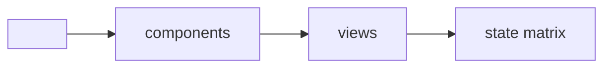

<!--
This file instantiates as <app>/DESIGN.md beside the code it describes. It is
the contract framework/design-standard.md defines: where code and this file
disagree, the change that noticed reconciles them, and the code's tests decide
which was right. Replace every <...>; delete a section only where the standard
says it does not apply (Platform is for mobile fronts).
-->

# DESIGN - <app name>

## Identity

<Who uses it, where, for how long. One paragraph.>

**The deciding sentence:** <the one line that picks between two valid designs,
e.g. "read for hours on a desktop: density over air">

## Tokens - `<path to the token file>`

No raw value is written outside this file; `tools/token-lint.sh` (or this
repo's own test, `<path>`) holds the count of exceptions to `<baseline>` and
only lets it fall.

| Role | Value | Use | Contrast pair |
|---|---|---|---|
| `<role>` | `<value or palette name>` | <where it is used> | <ratio on its ground> |

**Spacing scale:** <e.g. 4 · 8 · 12 · 16 · 24 · 32 · 48 px, token names>
**Type scale:** <sizes with their line heights, token names, the faces and their fallbacks>
**Radius · elevation · motion:** <tokens; motion respects prefers-reduced-motion>

## Components

| Component | States | Pattern it follows | Notes |
|---|---|---|---|
| `<name>` | <default, hover, focus, disabled, selected, error> | <source pattern> | <constraints> |

## State matrix

For every data-bearing view: how each state looks here.

| View | Empty | Loading | Error | Long content | Direction | Narrow |
|---|---|---|---|---|---|---|
| <view> | <what shows + the filling action> | <skeleton shape> | <message + recovery> | <wrap or scroll rule> | <RTL behaviour> | <smallest width> |

## Platform (mobile fronts)

<Which HIG and Material behaviours are followed - navigation, back, gestures,
target sizes - and each deliberate departure with its reason.>

## Quality bar

- Contrast: <the pairs above, 4.5:1 text, 3:1 large text and UI parts>
- Shipping sizes: <widths the views are checked at>
- Themes: <light, dark, or the one committed theme and why>
- Accessibility: axe-core in <browser test path>, no new violations
- Visual baselines: <snapshot location and update rule>
