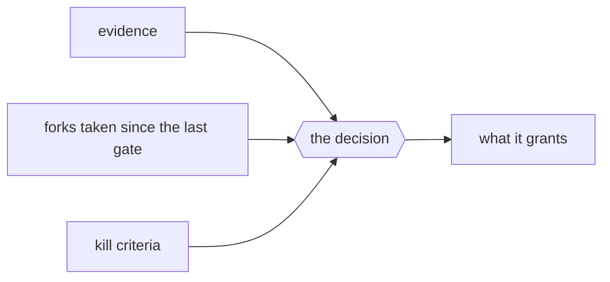

<!--
One gate, one decision. The founder reads this page once and answers once.
Everything the decision needs is here; everything it does not need is not.
-->

# Gate: <name> - <product name>

## The decision asked

<One sentence, answerable with yes, no, or yes with named changes.>

## The recommendation

<Yes or no, and the two or three facts that decide it.>

## Evidence

<The phase outputs this gate rests on, each linked. Every claim keeps its
label: sourced with a date, [UNVERIFIED], proto-persona, untested, draft.>

**What the bet still rests on, untested:** <the value and usability risks and
anything unverified, stated plainly>

## Forks taken since the last gate

| Fork | Taken | Alternative | Cost to reverse now |
|---|---|---|---|
| <the choice> | <the branch taken> | <the other> | <a redraft / a rebuild / nothing> |

## Kill criteria

| Criterion | Status | Evidence |
|---|---|---|
| <from the brief> | <clear / at risk / tripped> | <link> |

## Spend

<Spent so far against the envelope, by phase; the next phase's estimate.>

## What this gate grants

<Exactly the actions the run may take after a yes, and nothing else. A grant
not written here is not given.>

## Founder actions

**Needed now:** <what only the founder can do before the next phase>

**Start now:** <long-lead items for later gates: store enrollment, a business
entity, payment accounts, domains, trademark clearance, legal review>

## Decision record

<The founder's words, the date, and any changes named. Written when decided.>
