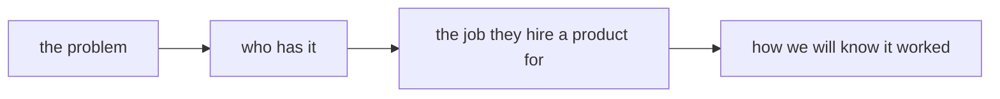

<!--
The product's one-page frame, written in Phase 0 and amended only at a gate.
/product-flow --resume reads this file first. Everything here is a claim the
later phases test; nothing here is evidence yet.
-->

# <name>

## The problem

<One paragraph in the words of the person who has it. No solution yet.>

## Who has it

<The segment, as specific as a sentence allows. Who has it worst, and how
they cope today: the competitive alternatives, including doing nothing.>

## The job to be done

<When <situation>, I want to <motivation>, so I can <outcome>.>

## Success metric

**North star:** <one metric that moves only when users get the value>
**Launch bar:** <the number by the first Learn run that means it is working>

## Constraints

<Budget, time, platform, legal or regulatory, language and direction,
anything fixed before design begins.>

## Kill criteria

Checked at every gate. Any one tripped is a stop recommendation, not a
rationalisation.

- <e.g. Discover finds a free alternative that does the job fully>
- <e.g. unit economics at the Gate 1 price cannot cover the Phase 4 cost model>
- <e.g. the launch bar missed by more than half at the first Learn run>

## Non-goals

<What this product will not do in its first release.>
