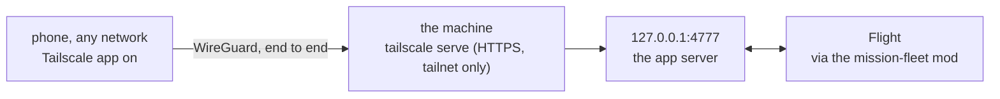

# Remote access - the Mission Control App from anywhere

> The app runs on the founder's machine and listens on 127.0.0.1 only. Reaching
> it from a phone in another city goes through a private network that only the
> founder's own devices join. Nothing is exposed to the public internet, ever.

## What this protects and what it does not

| Layer | Holds against | Does not hold against |
|---|---|---|
| 127.0.0.1 bind | every other device on any network | a process on the same machine |
| Tailscale `serve` | anyone not signed into the founder's tailnet | a device the founder added to the tailnet |
| Per-start token | other local web pages, other browsers, a stale link | a same-user process that reads the session transcript where the link was printed |
| Fleet guard | Controllers and their back rooms reaching the app or its token | a script file an agent writes and runs later (see the guard's header) |

The token is printed once when `/console app` starts it and is stored nowhere
else. Restarting the app issues a new one and invalidates the old link.

## One-time setup

1. **The machine.** Install Tailscale (`brew install --cask tailscale` or the App
   Store), open it, sign in. In the admin console: turn on **MagicDNS** and
   **HTTPS certificates**, and **disable key expiry** for this machine so it does
   not drop off the tailnet while the founder is away.
2. **The account.** Two-factor authentication on the identity the tailnet signs
   in with. Optional and stronger: **Tailnet Lock**, so a new device needs an
   existing device's approval.
3. **The phone.** Install the Tailscale app, sign in with the same account, and
   turn the VPN on. Only one VPN runs at a time on iOS.

## Each time

1. At the terminal: `/console app` starts the app and prints its link.
2. Serve it to the tailnet: `tailscale serve --bg 4777` (the port the link
   names). The HTTPS name is `https://<machine>.<tailnet>.ts.net`.
3. On the phone: open `https://<machine>.<tailnet>.ts.net/?t=<token>` once; the
   page keeps the token in its own storage and drops it from the address bar.
   Add it to the home screen for a full-screen app.

The machine must stay awake and online: `caffeinate -dis` beside the session, on
power. A lid-closed Mac sleeps unless it is on power with an external display.

## Phone alerts

When a Controller's report opens a gate, the mission-fleet mod sends one line
through Claude Code's notification tool. It reaches the phone only while
**Remote Control** is connected to this session; otherwise it is a desktop
notification, and the tool skips it entirely while the founder is at the
terminal. The audit log records which (`alert ... -> Mobile push not sent
(Remote Control inactive)`). The app's Poll badge shows the same gate either way.

## Never

- **Never `tailscale funnel`.** Funnel publishes to the public internet; this
  app can start agents and answer go/no-go gates.
- **Never ngrok or any tunnel without its own login in front.**
- **Never bind the server to 0.0.0.0** or a LAN address.

## Kill switches

| From | Do | Effect |
|---|---|---|
| The app | menu, then "Stop the app server" | the server stops; the link dies |
| The app | menu, then "Dismiss every console" | every Controller ends, nothing written |
| The terminal | `/console app stop` | the server stops |
| The phone, without the app | turn the Tailscale VPN off, or remove the device in the admin console | remote access ends at once |
| The machine | `tailscale serve reset` | the tailnet route is removed |

## Base branches: the control that holds

The fleet guard catches a Controller pushing to a base or deploy branch; it is a
text guard and not a sandbox. The control that holds is server-side branch
protection with administrators included, because Controllers push with the
founder's credentials:

- required pull request before merging (0 approvals for a solo founder);
- **include administrators** on; force pushes and deletions blocked.

Private repositories need a paid plan for branch protection (GitHub Pro for a
personal account, Team for an organization). Record each repo's state in its
spoke; a repo without protection is one where a Controller's push guard is the
only line.
