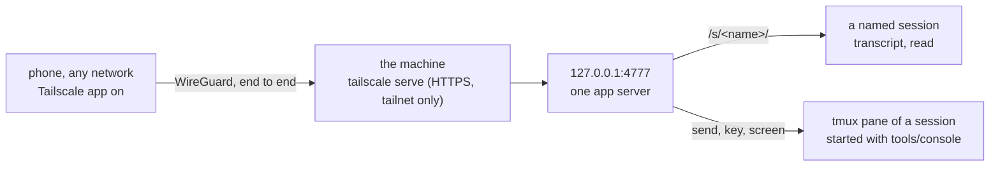

# Remote access - the Mission Control App from anywhere

> The app runs on the founder's machine and listens on 127.0.0.1 only. Reaching
> it from a phone in another city goes through a private network that only the
> founder's own devices join. Nothing is exposed to the public internet, ever.

## What this protects and what it does not

| Layer | Holds against | Does not hold against |
|---|---|---|
| 127.0.0.1 bind | every other device on any network | a process on the same machine |
| Tailscale `serve` | anyone not signed into the founder's tailnet | a device the founder added to the tailnet |
| Tailnet sign-in | a request that does not come through `tailscale serve` on this Mac's own tailnet name, or that carries another Tailscale login | a same-user process that sets both headers itself |
| App token | other local web pages, other browsers, a stale link | a same-user process that reads the token file or the session transcript where the link was printed |
| Push-to-base prompt | a session pushing to a base or deploy branch without the founder's yes | a script file a session writes and runs later, which the guard cannot read (it is a text guard, not a sandbox) |

## How a request is let in

A data request to the app (`/sessions.json`, `/s/<name>/state.json`, `/events`,
`/screen`, `/send`, `/key`, uploads, `/file`, `/file-ticket`, `/files.json`) is
accepted on either of two proofs:

- **Tailnet sign-in.** A request that arrives through `tailscale serve` on this
  Mac's own tailnet name carries the viewer's Tailscale login, and `serve` sets
  that header itself. When the login is the owner's, no token is needed. The
  server reads the owner's login and this Mac's tailnet name once from the local
  Tailscale client; with Tailscale absent, the token is the only way in. Funnel
  requests carry no login.
- **The app token.** One persistent token, kept at `~/.mission-control/app-token`
  (mode 0600). The server writes it when it is missing and it survives
  restarts. Revoke it by deleting the file and restarting the app; the next
  start issues a new one.

The Host header must be loopback or a Tailscale name, and a POST must come from
the page's own origin.

## One server, one URL per session

One app server runs per machine, on port 4777 (`MCAPP_PORT`), whatever Claude
profile or folder the sessions run in. A session is a terminal running
`claude -n <name>`; its hook registers it under `~/.mission-control/sessions/`
and the app shows it at `/s/<name>/`, read from its transcript. The front page
lists every session; the session view has a switcher between them. One token
covers all of them.

`node tools/console app --code <name>` starts the server when it is down and
prints the session's link; from a shell it also launches `claude -n <name>` in
a detached tmux session `mc-<name>`. `node tools/console app stop` stops the
server.

## What the app does

- **Shows a session.** Its messages as Markdown, live, with the folder and
  whether its process still runs. An ended session stays readable.
- **Types into a session that runs in tmux.** The text goes in as one bracketed
  paste (no shell, control characters dropped) and Enter; a session not run
  through `tools/console` is read-only, and the composer says how to reopen it.
- **Answers the terminal's own question.** A permission prompt or numbered
  choice on the session's screen shows as buttons; a tap presses that key. That
  includes the prompt raised by the push-to-base guard, so a push can be
  approved from the phone.
- **Photos and documents.** A file attached in the app is stored under
  `~/.mission-control/uploads` so the session can read it. Files are pruned
  after 7 days, and the folder never holds more than 200 files or 256 MB (oldest
  first).
- **Files on the Mac.** Nothing on the Mac is reachable from the phone by
  default. The founder or Flight shares one file at a time with `/share
  <path>` (`.claude/skills/share/SKILL.md`), which prints its tailnet link;
  `/share --list` shows what is shared and `/share --revoke <path>` stops it.
  The list holds each file's real path and lives in the app home
  (`~/.mission-control/shared-files.json`), never in the repository; an agent
  running as the same Mac user could change it, and what it shared would still
  open only for the owner. The instance's own state and the app's home are
  never shared. A path in
  a message or card links to the viewer (`view.html`, a new tab, so the
  session keeps its place) only when that file is shared; any other path
  stays plain text. Markdown renders as in the chat, text and images show in
  the viewer, and a PDF or HTML report opens as itself through a single-use
  ticket the server issues for that one file (it works once, within a
  minute), so no URL ever carries the app's token. The server shows a shared
  file read-only, as it is now: one that moved, or whose path now resolves
  somewhere else (a symlink put in its place), is a 404. A `..` in the path, a
  folder, a symlink, anything in a `.git`, `node_modules`, `secrets`, `.aws`,
  `.ssh`, `.gnupg`, `.config`, `gcloud`, `launch` or `credentials` folder, a
  data file (`.json`, `.txt`, `.yml`, `.yaml`, `.log`, `.csv`) whose name holds
  key, secret, token, credential, passw or private, and a service account,
  Firebase admin key, `.env`, key, certificate or Terraform variable or state
  file is refused when shared and again when requested, even if added to the
  list by hand. Every file is sent with a locking-down Content-Security-Policy
  (sandboxed, so an HTML report runs no script and never shares the app's
  origin; a PDF without the sandbox flag, which some PDF viewers refuse),
  `Cross-Origin-Resource-Policy: same-origin` and `Referrer-Policy:
  no-referrer`.

## One-time setup

1. **The machine.** Install Tailscale (`brew install --cask tailscale` or the App
   Store), open it, sign in. In the admin console: turn on **MagicDNS** and
   **HTTPS certificates**, and **disable key expiry** for this machine so it does
   not drop off the tailnet while the founder is away. Install tmux
   (`brew install tmux`) to type into sessions from the phone.
2. **The account.** Two-factor authentication on the identity the tailnet signs
   in with. Optional and stronger: **Tailnet Lock**, so a new device needs an
   existing device's approval.
3. **The phone.** Install the Tailscale app, sign in with the same account, and
   turn the VPN on. Only one VPN runs at a time on iOS.

## Each time

1. At a terminal: `node tools/console app --code <name>` (or `/console app
   --code <name>` inside a session) prints the session's link.
2. Serve it to the tailnet: `tailscale serve --bg 4777` (the port the link
   names). The HTTPS name is `https://<machine>.<tailnet>.ts.net`.
3. On the phone: open `https://<machine>.<tailnet>.ts.net/`. Signed in to the
   founder's Tailscale login, it needs no token. If it asks for one, open
   `https://<machine>.<tailnet>.ts.net/?t=<token>` once; the page keeps the token
   in its own storage and drops it from the address bar. Add it to the home
   screen for a full-screen app.

The machine must stay awake and online: `caffeinate -dis` beside the session, on
power. A lid-closed Mac sleeps unless it is on power with an external display.

## Never

- **Never `tailscale funnel`.** Funnel publishes to the public internet; this
  app types into terminals that can run commands.
- **Never ngrok or any tunnel without its own login in front.**
- **Never bind the server to 0.0.0.0** or a LAN address.

## Kill switches

| From | Do | Effect |
|---|---|---|
| The terminal | `node tools/console app stop` | the server stops; the link dies |
| The terminal | `tmux kill-session -t mc-<name>` | that session ends and the app can no longer type into it |
| The phone, without the app | turn the Tailscale VPN off, or remove the device in the admin console | remote access ends at once |
| The machine | `tailscale serve reset` | the tailnet route is removed |
| The machine | delete `~/.mission-control/app-token` and restart the app | every old link stops working |

## Base branches: the control that holds

The push-to-base hook (`tools/guard/guard.mjs`) asks before a push to a base or
deploy branch; it is a text guard and not a sandbox. The control that holds is
server-side branch protection with administrators included, because sessions
push with the founder's credentials:

- required pull request before merging (0 approvals for a solo founder);
- **include administrators** on; force pushes and deletions blocked.

Private repositories need a paid plan for branch protection (GitHub Pro for a
personal account, Team for an organization). Record each repo's state in its
spoke; a repo without protection is one where the prompt is the only line.
