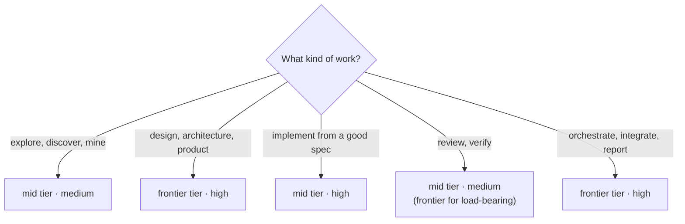

# Roles - the SDLC routing reference (not a roster)

> Honors `routing-grid.md`: *the model dial is the durable lever; the named-agent wrapper is convenience.* So instead of a bespoke agent zoo, this is a reference table mapping SDLC work to a recommended built-in agent or skill, a model x effort preset, and the escalation trigger. Any equivalent agent slots in.

Model tiers here mean: the cheap tier, the mid tier, and the frontier tier of whatever model family your harness runs (on Claude Code: the current cheap, mid and frontier models plus the one above the frontier for final synthesis - named, priced and dated in your instance's `CONSTITUTION.local.md`, because the framework speaks in tiers and never pins a model).

**The console fleet's words** (`.claude/skills/console/SKILL.md`): Flight is the orchestrator session; a Controller owns one front or project on a console with a call sign; its sub-agents are its back room; their messages are the loops; the go/no-go poll holds what waits on the founder; the Front Room is the Mission Control App. A Controller is one more dispatch: staff it on the routing preset for its work (the Controller row below) and retune it on evidence.

**Ceilings first:** the routing ceilings in `_command/CONSTITUTION.local.md` cap these presets - a frugal posture steps each row down; a missing tier maps to the nearest available one (no frontier tier at all: every frontier row falls to the mid tier, and judgment work earns `--thinking high` instead). Presets are defaults, not entitlements. An invocation's `--spend lean` steps dispatches one further tier down, always below the ceilings, never above.

| SDLC work | Use (built-in) | model x effort | Escalate when |
|---|---|---|---|
| Discovery / research | an explore/research agent + web search | mid · medium | cross-source judgment: frontier · high |
| Product / requirements | the session + a brainstorming skill | frontier · high | - |
| Architecture / API | an architect/plan agent | frontier · high | - |
| Design direction (UI-shaped tickets, Phase 1) | the session + a design skill, against the front's DESIGN.md and `design-standard.md` | frontier · high | a new view pattern or a new front: xhigh |
| Design review lens (Phase 5) | a design-review agent with the diff, the comp and the rendered screenshots | mid · medium | a new component, a cross-view change, or an accessibility finding it cannot settle: frontier · high |
| Implementation | an implementer agent + test-driven development | mid · high | core / load-bearing logic: frontier |
| Spec compliance review | a spec-reviewer agent | mid · medium | - |
| Quality review | a code-quality reviewer | mid · medium | load-bearing: frontier · high (two-stage) |
| Debugging | a systematic-debugging discipline (+ implementer) | mid · high | - |
| Security | a silent-failure / security review | mid · medium | - |
| Docs / ADR | the session (light) | mid · low | - |
| Orchestration | the session itself | frontier · high | final synthesis: xhigh |
| Epic current-state audit (E1) | a read-only explorer agent | mid · medium | a data-path or infra surface in question: mid · high |
| Epic architecture (E2) | an architect/plan agent + the session | frontier · high | - |
| Controller (one front or project, staffed with `/console staff`) | a Controller on its console, which runs `/mission-flow` and `/epic-flow` for its scope | the cheapest that holds the bar: the work's own row above, haiku-tier for mechanical work, sized at staffing as `<n> Controllers x model x effort, back-room budget <b> each` | retune on evidence with `/console retune`; never staffed by a direct Agent call |
| Controller back room (its own sub-agents, up to its budget, default 4) | the Agent tool, dispatched by the Controller | the work's own row above | the Controller asks Flight for more than its budget; a back room cannot push, and cannot use Workflow |

**Design is not implementation.** Layout, hierarchy and states are decided at the design-direction row, before an implementer is dispatched; an implementer that has to invent a layout was briefed without a comp, and the brief goes back, not forward (`design-standard.md`, principle 1).

**Review-depth is a third dial** (see `learning-seed/02-integration-truth-and-review-economy.md`): heavy two-stage review (spec, then quality, separate reviewers) for new core logic, security-critical code, and the make-or-break feature; lighter combined single-reviewer passes for small fixes, config, and mechanical threading. Log the choice as deliberate, never a silent skip.

**Fan-out sizing (binding, from `routing-grid.md`):** before ANY parallel batch of agents, state the size - **N agents x model x effort, roughly estimated in tokens** - and get an explicit go. A "go" on a goal is never a "go" on N expensive agents. Escalate on evidence, not anxiety: start at the lowest dials that could plausibly hold the bar and re-run higher only if the output actually fails.

**A dispatched agent inherits the parent's git credentials** - the SSH agent socket, the `gh` token and the configured credential helper all carry over, established by probe rather than assumed. Isolating an agent's working tree therefore does not isolate the remote: a write-capable dispatch can push to any branch those credentials reach. For a plain Agent dispatch no dispatch-time control exists, so the outbound path is held by instruction plus checking the tree and the remote after the agent finishes, never by anything that blocks the push before it happens. This is the canonical statement; a skill that dispatches applies it rather than restating it.

**Fleet-staffed agents are the exception, and only partly.** A Controller and its back room run under the mission-fleet guard, which refuses at tool-call time a push to a base or deploy branch, a force push, a stash, a PR merge and a write to a Flight-owned file; a back room may not push at all. That guard is a text guard, not a sandbox: it catches mistakes and steered agents, and a script file an agent writes and runs later is outside what it can read. The control that holds is server-side branch protection with administrators included (`remote-access.md`). The tree-and-remote check after the agent finishes still applies.
