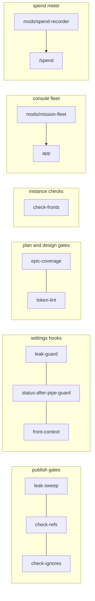

# tools

Everything under `tools/` is a gate, a hook or a local app. Gates and hooks are
shell or PowerShell scripts, opt-in per instance, never calling a model.



| Tool | What it does | Platforms |
|---|---|---|
| `leak-sweep` | scans text for anything that identifies the operator, before it ships | `.sh`, `.ps1` |
| `leak-guard` | hook: blocks process vocabulary in commits, PRs and tracker writes | `.sh`, `.ps1` |
| `check-refs` | every repo path and link a doc names must exist | `.sh` (with `.py`), `.ps1` |
| `check-ignores` | the paths that must be gitignored are, and the ones that ship still can | `.sh` + `.py`, `.ps1` |
| `check-fronts` | each front's folder holds its repos, and no worktree sits at the top of `fronts/` | `.sh` + `.py` |
| `epic-coverage` | the E4 gate of epic-flow | `.sh`, `.py` |
| `status-after-pipe-guard`, `front-context` | settings hooks | `.sh` |
| `token-lint` | the design-token ratchet | `.sh`, `.py` |
| `mods/mission-fleet` | the console fleet, a Claude Code plugin | TypeScript |
| `mods/spend-recorder` | records the tokens every model call used, for `/spend` | TypeScript |
| `app/` | the Mission Control App | Node |

On macOS and Linux use the `.sh` entry points; the `.ps1` twins exist for
Windows, and a tool listed with only one form has no twin yet.

## leak-sweep

The personalization firewall. It scans text for anything that identifies the
operator (names, emails, paths, secrets, old brand names) before it ships.

The two scripts enforce the same rules. One platform note: on user-path rules
the .ps1 uses a lookahead and the .sh an equivalent character class, so
templated examples like `C:\Users\<NAME>` pass both; prefer `~/` style paths
in shipped examples anyway.

Two run-sites, two rule sets:
- **promote mode** - before anything is published: the generic identity
  rules (paths, emails, keys, the legacy name) + your deny-list. Guards
  the PUBLIC repo.
- **instance mode** - at the end of LIFTOFF Stage 4 and inside
  `/preflight`: leftover template placeholders (`<PLACEHOLDER-...>`,
  `{{TOKEN}}`, `TODO-INIT`) + your deny-list if present. It does NOT run
  the identity rules - a private instance legitimately contains its own
  founder's paths and email. It reads `_command/` and the operating
  `CLAUDE.md`, not `framework/`, whose kit templates carry placeholders on
  purpose. The brace token must be a bare identifier, so a Mermaid hexagon
  node (`A{{"label"}}`) is not mistaken for an unfilled blank; an unquoted
  one (`A{{plain}}`) still needs the exempt marker.

Usage. **The first positional argument is the MODE in both entry points**, and
each mode picks its own targets, so a bare mode is the normal invocation:

- `tools/leak-sweep.sh [promote|instance] [root]`
- From a PowerShell session: `.\tools\leak-sweep.ps1 [promote|instance] [-Path <p1>,<p2>] [-PrivateList <file>] [-Root <dir>]`
- From any shell: `powershell -Command ".\tools\leak-sweep.ps1 instance"`
  (do not use `powershell -File` with a multi-value `-Path` - argument arrays do not survive `-File`)

Where the two still differ, because it is the kind of thing that gets
transliterated wrongly: the shell script takes the scan root as an optional
SECOND positional, while the PowerShell one takes `-Root` and `-Path` as named
parameters only. `$Mode` was not always first in the PowerShell param block, and
while it was second a bare `leak-sweep.ps1 promote` bound "promote" to `-Path`,
scanned nothing and exited 0.

Exit 0 means clean. Exit 1 prints `file:line: [rule] match` for each hit. Exit 2
means the sweep could not do its job and you should not read it as a pass: a
target that is absent or empty, a file it cannot open, or a rule whose pattern
grep rejected. `instance` on a pre-liftoff clone exits 2 for that reason, since
there is no `_command/` to check yet.

A line intentionally naming the operator can be exempted with a trailing
`MC-LEAK-EXEMPT: <reason>` marker.

`tools/leak-sweep.private.txt` is the operator's own deny-list, one term per
line, gitignored so it never ships. Cloners of this repo create their own.

## check-refs

The second gate: every repo path a doc names must exist on disk, and every
relative Markdown link must resolve. It exists because removing a subsystem
once left prose references to deleted files that a filename grep could not
catch.

- `bash tools/check-refs.sh [path ...]` (with `tools/check-refs.py`, Python 3
  only) is the shell twin and the one to use on macOS and Linux. It checks
  paths under `framework/`, `.claude/skills/`, `kit/` and `tools/`, and
  relative links; links written inside code, links in the instance
  templates and gitignored paths are not counted as broken. It takes files or
  folders (default: every tracked `.md`).
- `tools/check-refs.ps1` is the original PowerShell form for Windows. It
  checks the `framework/`, `.claude/skills/` and `kit/` paths only.

Exit 0 is clean, 1 prints `file:line` for each broken reference, and 2 means a
named path does not exist. Run it with the sweep before any publish.

## check-ignores

`tools/check-ignores.sh` (with `check-ignores.py`) and `tools/check-ignores.ps1` are the third gate; the bash
twin reads its lists from the `.ps1`, so there is one list. The paths that must be
gitignored are, and the paths that must ship still can be (exit 0 clean /
1 listing each problem). Where the sweep reads file contents, this one
reads the rules, because a doc claiming a path is ignored proves nothing
about what git will do. `/preflight` step 6 runs it at every spend tier.

## check-fronts

An instance check, run by `/preflight` step 2. Every front is a folder under
`fronts/` holding that front's repos, `fronts/<front>/<repo>`
(`framework/task-board.md`, front placement). `bash tools/check-fronts.sh
[root]` (with `check-fronts.py`, Python 3; the root defaults to the folder
above `tools/`) reads the folders directly under `fronts/` and prints one line
per problem, with the commands that fix it, run from the root (a path after
`git -C <repo>` is relative to that repo, because git reads it from there):

- a repo: a `.git` folder, a `.git` file naming a separate git directory, or a
  bare repo (`HEAD`, `objects/` and `refs/` in the folder itself). The front's
  folder is itself a repo, so a second repo for that front has nowhere to go.
  The fix houses it at `fronts/<front>/<front>` (a bare `fronts/<name>.git` at
  `fronts/<name>/<name>.git`) and names the `git worktree repair` its linked
  worktrees need afterwards, with the new path of each one that moves with it.
- a `.git` file naming a linked worktree: a worktree at the top of `fronts/`,
  outside its front's folder. The fix is a `git worktree move` beside its repo,
  after that repo's own fix when the repo is at the top of `fronts/` too.
- a worktree whose repo has moved (its `.git` file names a git directory that
  is gone, as after a repo's fix and before the repair): the fix is the
  `git worktree repair` in the repo's new home, then the move.

It reads only and moves nothing. Exit 0 is clean (also when there is no
`fronts/`, as in this clone), 1 lists the problems, and 2 means it could not
check: the root does not exist, `fronts/` is not a folder, or a folder cannot
be read. Tests: `tests/check-fronts.tests.sh`. A `.ps1` twin is deferred
until a Windows operator exists; there, run the `.py` with Python 3.

## epic-coverage (`epic-coverage.sh` / `epic-coverage.py`)

The E4 gate of epic-flow: diffs fragment-owned outputs against the
architecture's declared outputs. Exit 1 on an unclaimed remainder or an
over-claim; undeclared claims warn. Tests: `tests/epic-coverage.tests.sh`
(both negative controls executable). A `.ps1` twin is deferred until a
Windows operator exists.

## leak-guard

The mechanical tier for outward artifacts: a `PreToolUse` hook that blocks
process vocabulary (a decision attributed to a person, orchestration terms,
authorship tells; the deliberation-label family is deliberately empty) before it reaches a commit, a PR or a
tracker write. The deny-list is `leak-guard.terms.txt`. What it scans, what it
refuses and how to tune the list: `framework/leak-guard.md`. Scripts:
`tools/leak-guard.sh` (needs `jq`) and `tools/leak-guard.ps1`. Wire it with the
`settings.local.json` block below; nothing is enabled by default.

## status-after-pipe-guard and front-context

Two more settings hooks beside the leak guard, same contract: a shell script the
harness runs regardless of the session's state, opt-in per instance, never
calling a model.

- **`status-after-pipe-guard.sh`** (`PreToolUse`, matcher `Bash`): blocks a
  command that reads `$?` after a pipe into tail, head, grep, sed, jq, tee or
  another presentation tool, because `$?` then reports the pager, which never
  fails. Three real runs printed a failure line and `exit=0` in the same
  breath, one of them a security gate. Allowed forms: capture on the
  command's own line (`cmd > log 2>&1; rc=$?; tail log`), `set -o pipefail`,
  or `${PIPESTATUS[0]}`. Exit 2 blocks with the fix on stderr. Tests:
  `tools/tests/status-after-pipe-guard.tests.sh`, blocked and passed forms
  both.
- **`front-context.sh`** (`UserPromptSubmit`): when a prompt invokes
  `/mission-flow` or `/epic-flow` with `--front <f>` (and optionally
  `--project <p>`), prints that front's hub and the repo's spoke to stdout, so
  they enter context before Phase 0. This is step zero of mission-flow made
  mechanical: a note read while diagnosing has already cost what it existed to
  prevent. Never blocks; a missing hub or spoke prints a notice instead. A
  120 KB cap falls back to a one-line instruction to read the file. Tests:
  `tools/tests/front-context.tests.sh`.

Wiring, in the instance's `.claude/settings.local.json` (gitignored):

```json
{
  "hooks": {
    "PreToolUse": [
      { "matcher": "Bash|mcp__.*", "hooks": [ { "type": "command", "command": "bash \"${CLAUDE_PROJECT_DIR}/tools/leak-guard.sh\"", "timeout": 10 } ] },
      { "matcher": "Bash",         "hooks": [ { "type": "command", "command": "bash \"${CLAUDE_PROJECT_DIR}/tools/status-after-pipe-guard.sh\"", "timeout": 10 } ] }
    ],
    "UserPromptSubmit": [
      { "hooks": [ { "type": "command", "command": "bash \"${CLAUDE_PROJECT_DIR}/tools/front-context.sh\"", "timeout": 10 } ] }
    ]
  }
}
```

Hooks load at session start, so a freshly wired hook is proven in the next
session, not the one that wired it. Both scripts need `jq`, like the guard.

## token-lint

The design-token ratchet from `framework/design-standard.md`, "The gates". It
counts raw colour literals and raw spacing and type values (padding, margin,
gap, inset, font-size, line-height, letter-spacing, as CSS properties or
camelCase style keys) in the files a front scans, skipping its token files and
every comment, and fails when a count rises above the baseline recorded in
`.token-lint.json` at the front's root:

```json
{ "tokens": ["app/globals.css"],
  "scan": ["app/**/*.css", "components/**/*.tsx"],
  "baseline": { "hex": 1, "spacing": 358 } }
```

- `tools/token-lint.sh <root>`: exit 0 at or under baseline, 1 over it, 2 when
  it cannot judge (no config, no baseline yet, patterns matching nothing).
- `tools/token-lint.sh <root> --update-baseline`: records today's counts the
  first time, and afterwards only ever lowers them; it refuses while any count
  is over.

A front adopting the standard late wires it at today's count: drift stops on
that day, and each conversion lowers the number for good. A front whose own
tests already hold a value class keeps that idiom. Tests:
`tools/tests/token-lint.tests.sh`, 14 cases with negative controls both ways.

## mods/mission-fleet

The console fleet: a Claude Code mod, packaged as a plugin, that adds
`/console` and a console tool for Flight (the orchestrator session). It staffs
a kept-alive Controller per front or project, retunes and calls it, keeps the
go/no-go poll and the loops, and guards what Controllers and their back rooms
may run. The verbs, the guard's limits and the founder-only commands are in
`.claude/skills/fleet/SKILL.md`; the remote runbook is
`framework/remote-access.md`.

Loading it. A mod is not on by default. Either set `CLAUDE_CODE_PLUGIN_DIRS`
in the `env` block of the profile's `settings.json` to the absolute path of
`tools/mods/mission-fleet`, or start a session with
`claude --plugin-dir tools/mods/mission-fleet`. It needs a Claude Code build
that supports mods.

Tests: `claude plugin test tools/mods/mission-fleet` (47 tests across
`controller`, `guards`, `loops` and `register` at the time of writing; the run
prints the count).

## mods/spend-recorder

The meter behind `/spend`: a Claude Code mod that records the model, effort
and token usage of every model call the session makes, the main session's and
each subagent's, summed per agent and kept in the plugin's store for the last
30 sessions. A subagent's line carries the description and type it was started
with. It prices nothing: prices live in the instance's routing doctrine, and
`/spend` applies them.

It adds `/spend-log` (this session's table; `--sessions` for one line per kept
session) and a `spend` tool the model calls with the same arguments, which is
how `/spend` reads it.

Loading it works as for mission-fleet: add the absolute path of
`tools/mods/spend-recorder` to `CLAUDE_CODE_PLUGIN_DIRS` (several paths join
with `:`), or start a session with `claude --plugin-dir
tools/mods/spend-recorder`. Calls made before it loaded are not recorded.

Tests: `claude plugin test tools/mods/spend-recorder` (10 tests on the ledger at
the time of writing; the run prints the count).

## app

The Mission Control App, a local web app for the fleet: Flight, Consoles,
Poll and Loops. `app/server.mjs` is Node standard library only, with no build
step. You do not run it by hand: `/console app` starts it from the mod, and
`/console app stop` ends it.

- One server runs per Claude profile. The one holding port 4777 is the front
  door: it serves the app and routes `/p/<profile>/` to the other profiles'
  servers, so one URL covers every profile.
- It listens on 127.0.0.1 only. Reaching it from a phone is through
  `tailscale serve`, never a public tunnel: `framework/remote-access.md`.
- The design, tokens and states: `app/DESIGN.md`. The token ratchet is held at
  zero: `tools/token-lint.sh tools/app`.
