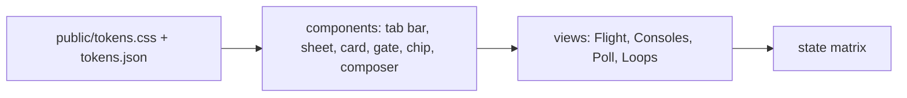

# DESIGN - Mission Control App

## Identity

The founder runs a fleet of agents from a phone, often away from the desk, in
short glances between other things: is anything waiting on me, what is each
console doing, answer it, move on. The same page opens on the laptop beside the
terminal. It is a control surface, read in seconds and operated with a thumb.

**The deciding sentence:** a glance answers "is anything waiting on me", and one
tap answers it; everything else is one sheet away.

Concept approved by the founder on 2026-10-15 (artifact "Mission Control App",
B341vXjnNZyzQiHRGJwGPq). The palette is the portfolio's own page system
(`.claude/skills/DESIGN.md`) extended with five state pairs, so a report and the
app read as one family.

## Tokens - `public/tokens.css` (mirrored in `tokens.json`, DTCG)

No raw value is written outside the token file; `tools/token-lint.sh tools/app`
holds the count of exceptions to the baseline in `.token-lint.json` (wired with
the first view in MC-100) and only lets it fall.

| Role | Light | Dark | Use | Contrast pair (light / dark) |
|---|---|---|---|---|
| `--bg` | `#FFFFFF` | `#111819` | page ground | |
| `--surface` | `#F1F5F5` | `#182123` | composer, chips, panels | |
| `--raised` | `#FFFFFF` | `#1D2729` | cards, sheets | |
| `--line` | `#D3DDDE` | `#2B3A3D` | rules, borders | decorative |
| `--ink` | `#1B2A2E` | `#E4EDEE` | text | on bg 14.82 / 15.10 |
| `--ink-soft` | `#44575C` | `#B3C3C6` | secondary text | on surface 6.92 / 9.01 |
| `--ink-faint` | `#56696E` | `#94A8AC` | captions, times | on surface 5.25 / 6.60 |
| `--accent` | `#0A6A70` | `#5CC4CB` | the one primary action, active tab | on bg 6.35 / 8.74 |
| `--accent-ink` | `#FFFFFF` | `#0B1415` | text on accent | on accent 6.35 / 9.08 |
| `--run` / `--run-tint` | `#0A6A70` / `#DDF0F1` | `#5CC4CB` / `#173538` | running | 5.38 / 6.37 |
| `--wait` / `--wait-tint` | `#8A5A00` / `#FBEFD5` | `#F0C26A` / `#3A2E14` | waiting on the founder | 5.20 / 7.99 |
| `--fail` / `--fail-tint` | `#A3262A` / `#F8E1E1` | `#F29A9C` / `#3D1E1F` | stopped, no-go, errors | 5.87 / 7.04 |
| `--done` / `--done-tint` | `#2E6B2F` / `#E2F1E0` | `#8FD48F` / `#1E3520` | go, done | 5.49 / 7.56 |
| `--idle` / `--idle-tint` | `#56696E` / `#E9EEEF` | `#94A8AC` / `#222D2F` | idle, stood down | 4.93 / 5.70 |

Ratios computed with the WCAG relative-luminance formula on 2026-10-15; the
lowest text pair is idle on its tint, 4.93:1, above 4.5:1. `GO` text uses
`--bg` on `--done` (6.44 / 10.25).

**Spacing scale:** `--s1` 4 · `--s2` 8 · `--s3` 12 · `--s4` 16 · `--s5` 24 · `--s6` 32 px.
**Type scale:** `--t-xs` 12/16 · `--t-sm` 13/18 · `--t-md` 15/22 · `--t-lg` 18/24 px; system faces
only (`--sans`: -apple-system, BlinkMacSystemFont, "Segoe UI", Roboto, sans-serif;
`--mono`: ui-monospace, "SF Mono", Menlo, monospace), because the app is served
from the founder's machine and must load nothing remote.
**Layout and motion tokens:** `--target` 44 px (the minimum target) · `--r-field` 12 px (fields, buttons) · `--lh-*` line heights paired with each `--t-*` · `--scrim` (sheet backdrop) · `--rise` 220 ms (sheet entry) · `--pulse` 1.2 s and `--pulse-step` .2 s (the working dots) · `--dim` .25 (their low point) · `--bubble` 88% (message width) · `--toast-lift` 96 px (toast above the bars).
**Letter spacing:** `--ls-1` .03em (button labels) · `--ls-2` .04em (call signs) · `--ls-3` .06em (small caps tags) · `--ls-4` .08em (section labels).
**Radius · elevation · motion:** `--r-chip` 999px · `--r-card` 16px · `--r-sheet` 22px;
one shadow, on the phone frame only; sheets rise 220 ms ease-out, and nothing
moves under `prefers-reduced-motion: reduce`.

## Components

| Component | States | Pattern it follows | Notes |
|---|---|---|---|
| Tab bar | default, selected, badge, focus | iOS tab bar / Material navigation bar (4 destinations) | bottom, thumb zone; Poll badge = open gates |
| Composer | empty, typing, sending, queued, refused | messaging composer | `/` opens the command sheet; Enter sends on desktop |
| Command sheet | open, filtered, empty result | bottom sheet + search | grouped by source; "at the Mac" mark for terminal menus |
| Console card | running, waiting, idle, stood down, failed, focus | list card with a state stripe | stripe + pill, never colour alone |
| Console sheet | default, retuning, confirming stand-down | bottom sheet | Call, Retune, Stand down; destructive action confirms in-page |
| Gate card | open, sending, decided, undelivered | action card | GO and NO-GO full height at thumb reach; Ask writes to Flight |
| State chip | five states | tinted pill | label carries the state |
| Loop row | status, call, decision, advisory | timeline row | advisory rows tinted `--wait-tint` |
| Toast | info, error | snackbar | announced via `role="status"` |

## State matrix

| View | Empty | Loading | Error | Long content | Direction | Narrow |
|---|---|---|---|---|---|---|
| Flight | "No messages yet. Ask Flight anything, or tap / for a command." | the link line reads "Connecting to Flight…" | link line "Reconnecting…" (EventSource retries); a refused send shows the server's reason | messages wrap; code blocks scroll in their own box | LTR only, stated | 320 px, one column |
| Consoles | "No consoles staffed." + the `/console staff` hint | four grey summary tiles | as Flight | task text wraps to 3 lines; the sheet shows all | LTR | 320 px |
| Poll | "Nothing is waiting on you." | summary only | as Flight; an undelivered decision shows in its card | title wraps; detail in a scroll box | LTR | 320 px |
| Loops | "No loop traffic yet." | none (data arrives with state) | as Flight | first line only; tap expands | LTR | 320 px, filter chips scroll sideways in their own row |

## Platform (mobile fronts)

A web app installed to the home screen (PWA manifest, standalone display). It
follows iOS and Material behaviour where they agree: bottom navigation with four
destinations, bottom sheets for detail, 44 px minimum targets, safe-area insets
on the bars, the system back gesture closing the open sheet. Departures: no
pull-to-refresh (the stream is live), no swipe actions (one tap is enough and
discoverable).

## Quality bar

- Contrast: every pair above at 4.5:1 or more in both themes, recomputed when a value changes.
- Shipping sizes: 320, 390 and 1280 px wide.
- Themes: light and dark, following the system setting.
- Offline: no http(s) load other than the app's own origin (CSP `default-src 'self'`).
- Accessibility: every control reachable by keyboard with a visible focus; every icon-only control (tab icons, the `/` button, sheet close) carries an accessible name; live regions for toasts and the link line; axe-core checked by the MC-100 screenshots run, no violations.
- Visual baselines: screenshots at 390 px, light and dark, in the MC-100 ticket folder.
