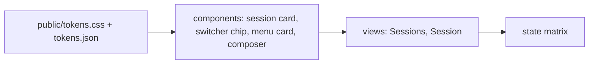

# DESIGN - Mission Control App

## Identity

The founder runs terminal sessions from a phone, often away from the desk, in
short glances between other things: is anything waiting on me, what is each
session doing, answer it, move on. The same page opens on the laptop beside the
terminal. It is a control surface, read in seconds and operated with a thumb.

**The deciding sentence:** a glance answers "is anything waiting on me", and one
tap answers it; everything else is one sheet away.

Concept approved by the founder on 2026-10-15 (artifact "Mission Control App",
B341vXjnNZyzQiHRGJwGPq). The palette is the portfolio's own page system
(`.claude/skills/DESIGN.md`) extended with five state pairs, so a report and the
app read as one family.

## Tokens - `public/tokens.css` (mirrored in `tokens.json`, DTCG)

No raw value is written outside the token file. `tools/token-lint.sh tools/app`
holds the count of exceptions to the baseline in `.token-lint.json`, which is at
the floor: hex 0, spacing 0. Any raw colour or spacing value added to a view
fails the check.

| Role | Light | Dark | Use | Contrast pair (light / dark) |
|---|---|---|---|---|
| `--bg` | `#FFFFFF` | `#111819` | page ground | |
| `--surface` | `#F1F5F5` | `#182123` | composer, chips, panels | |
| `--raised` | `#FFFFFF` | `#1D2729` | cards, sheets | |
| `--line` | `#D3DDDE` | `#2B3A3D` | rules, borders | decorative |
| `--ink` | `#1B2A2E` | `#E4EDEE` | text | on bg 14.82 / 15.10 |
| `--ink-soft` | `#44575C` | `#B3C3C6` | secondary text | on surface 6.92 / 9.01 |
| `--ink-faint` | `#56696E` | `#94A8AC` | captions, times | on surface 5.25 / 6.60 |
| `--accent` | `#0A6A70` | `#5CC4CB` | the one primary action, active tab | on bg 6.35 / 8.74 |
| `--accent-ink` | `#FFFFFF` | `#0B1415` | text on accent | on accent 6.35 / 9.08 |
| `--run` / `--run-tint` | `#0A6A70` / `#DDF0F1` | `#5CC4CB` / `#173538` | running | 5.38 / 6.37 |
| `--wait` / `--wait-tint` | `#8A5A00` / `#FBEFD5` | `#F0C26A` / `#3A2E14` | waiting on the founder | 5.20 / 7.99 |
| `--fail` / `--fail-tint` | `#A3262A` / `#F8E1E1` | `#F29A9C` / `#3D1E1F` | stopped, no-go, errors | 5.87 / 7.04 |
| `--done` / `--done-tint` | `#2E6B2F` / `#E2F1E0` | `#8FD48F` / `#1E3520` | go, done | 5.49 / 7.56 |
| `--idle` / `--idle-tint` | `#56696E` / `#E9EEEF` | `#94A8AC` / `#222D2F` | idle, stood down | 4.93 / 5.70 |

Ratios computed with the WCAG relative-luminance formula on 2026-10-15; the
lowest text pair is idle on its tint, 4.93:1, above 4.5:1. Text on a solid `.go` button uses
`--bg` on `--done` (6.44 / 10.25).

**Spacing scale:** `--s1` 4 · `--s2` 8 · `--s3` 12 · `--s4` 16 · `--s5` 24 · `--s6` 32 px.
**Type scale:** `--t-xs` 12/16 · `--t-sm` 13/18 · `--t-md` 15/22 · `--t-lg` 18/24 px; system faces
only (`--sans` and `--mono`, the full stacks in `public/tokens.css`), because the app is served
from the founder's machine and must load nothing remote.
**Layout and motion tokens:** `--target` 44 px (the minimum target) · `--r-field` 12 px (fields, buttons) · `--lh-*` line heights paired with each `--t-*` · `--scrim` (sheet backdrop) · `--rise` 220 ms (sheet entry) · `--pulse` 1.2 s and `--pulse-step` .2 s (the working dots) · `--dim` .25 (their low point) · `--bubble` 88% (message width) · `--toast-lift` 96 px (toast above the bars) · `--prof-max` the smaller of 9.5 em and 40% of the screen (the profile switcher's widest; a longer name ends in an ellipsis) · `--att-name` 8 em (a file's name in the attachment tray before its ellipsis) · `--cell-long` 12 em (the narrowest a long table cell wraps to).
**Letter spacing:** `--ls-1` .03em (button labels) · `--ls-2` .04em (call signs) · `--ls-3` .06em (small caps tags) · `--ls-4` .08em (section labels).
**Radius · elevation · motion:** `--r-chip` 999px · `--r-card` 16px · `--r-sheet` 22px;
no shadows; sheets rise 220 ms ease-out, and nothing
moves under `prefers-reduced-motion: reduce`.

## Components

| Component | States | Pattern it follows | Notes |
|---|---|---|---|
| Session composer | typing, sending, read-only (not in tmux), ended | messaging composer in the session view (`/s/<name>/`) | the text goes into the session's terminal through tmux, so it reads exactly as typed; a session not run in tmux, or one that ended, disables the field and says why in one line above it, naming `node tools/console app --code <name>` |
| Terminal menu card | hidden, two options, three or more, answering | `.gate` action card above the composer | read from the session's screen while the page is open: the question, then one button per numbered option (the option under the cursor filled, the rest outlined), 44 px targets; a tap presses that option's key; a permission prompt for a push to a base branch is answered here |
| Sessions list | none, one or more, ended, unreachable, needs the link | list of `.session` link cards on the front page | one card per named session: its name, its folder, a dot and the words Running or Ended, and "you can type into it" or "read-only"; an ended one has a dashed border; each card is one 44 px+ target; none says how to start one: `node tools/console app --code <name>` |
| Session switcher | hidden (fewer than two sessions), current, ended | row of `.chip` links under the session header, scrolling sideways | the current session's chip is filled in the accent tint and carries `aria-current=page`, an ended one is dashed; the header's back arrow returns to the list |
| Toast | info, error | snackbar | announced via `role="status"`; used for a refused send or a refused file |
| Attachments | hidden, picked (1 to 10), sending (locked), refused (toast) | paperclip button beside `/` + a tray above the composer | the paperclip ("Attach photos or files") opens a picker for several files: photos, downscaled on the device to 1600 px JPEG, and PDF, `.txt`, `.md`, `.csv` or `.json` files, sent as they are. At most 8 MB a file, 10 files and 32 MB a message, checked in the page before a file joins and again by the server, which reads each file's own bytes; files not added are named in one toast with why. The tray scrolls sideways in its own row: each item, on `--surface` with a `--line` border and `--r-field` corners, holds a photo thumbnail or a type badge (`.ftype`, the extension in mono), the name ending in an ellipsis at `--att-name`, and a remove button of `--target` size named "Remove <name>"; a hint line reads "3 of 10 files · 4.1 of 32 MB". A slash command with attachments is refused ("Remove the attachments to run a command."). Each file travels as one line at the end of the message naming its stored path; the line is never shown |
| Sent photos | one, several, loading, gone | inside the sent bubble, above its text | one at most 40 vh high; several in a two-column grid of square crops; a photo still loading, or no longer on the Mac, is a `--surface` placeholder that says so |
| Document chip | loading, ready (a link), gone | inline chip in the sent bubble, below its photos | on `--surface` with a `--line` border, `--r-field` corners and `--target` high: the type badge and the name, ending in an ellipsis. Ready, it opens the file in a new tab from a blob of a fixed type (a PDF as PDF, every text file as plain text), fetched with the token in a header so the token never sits in the page; loading reads "<name> · loading", gone "<name> · no longer on the Mac". On the accent bubble its focus ring is `--accent-ink` |
| Theme choice | System (default), Light, Dark | a segmented control in the menu sheet | kept per device in localStorage; `public/theme.js` sets `data-theme` on `<html>` before first paint (the CSP allows no inline script); `tokens.css` applies the dark palette for a dark device unless Light is chosen, and always for Dark |
| Markdown reply | default, badged (a first-line call-sign marker) | rendered by `public/md.js` | headings, emphasis, code, lists, quotes, http(s) links in a new tab, tables in their own horizontal scroll: the reply then takes the chat column's whole width, a cell of up to 24 characters keeps to one line and a longer one wraps at its spaces (at least `--cell-long` wide), so a word never breaks to fit, and a shadow at an edge shows more lies that way; the scroll box is a named region a keyboard can reach; text escaped before markup; a first-line marker becomes Call-sign chips beside FLIGHT and leaves the text |

## State matrix

| View | Empty | Loading | Error | Long content | Direction | Narrow |
|---|---|---|---|---|---|---|
| Sessions | "No named session yet" with the command that starts one | the link line reads "Connecting…" | "Couldn't reach the Mac" in the link line; a missing link says to open the one the console printed | a long folder wraps | LTR | 320 px |
| Session | "Nothing said in this session yet." | the link line reads "Connecting…" | "Reconnecting…" in the link line; an unknown name says how to start it | a long reply scrolls in its bubble; a table scrolls sideways | LTR | 320 px |
| Ended session | its last messages stay; the composer is disabled and says why | not applicable | not applicable | as Session | LTR | 320 px |
| Attachments | none attached | a file is uploading while the field waits | a refused file is named with the reason in one toast | at most 10 files, 8 MB each | LTR | 320 px |

## Layout

One column at every width, at most 720 px wide and centred; sheets and rails are not used. The session view is a header (back arrow, name, link line), the switcher, the conversation, the terminal menu card when the session asks, and the composer.

## Sessions

One server runs per machine and serves every named session at `/s/<name>/`; one URL and one token cover them all. A session is registered by the session hook and shown by reading its transcript. Typing needs the session to run in tmux (`node tools/console app --code <name>` starts it there); any other session is read-only.

## Platform (mobile fronts)

A web app installed to the home screen (PWA manifest, standalone display). It follows iOS and Material behaviour where they agree: 44 px minimum targets, safe-area insets on the bars; no pull-to-refresh (the stream is live), no swipe actions (one tap is enough and discoverable).

## Quality bar

- Contrast: every pair above at 4.5:1 or more in both themes, recomputed when a value changes.
- Shipping sizes: 320, 390 and 1280 px wide.
- Themes: light and dark, following the system setting unless the founder picks Light or Dark in the menu (Theme choice).
- Offline: no http(s) load other than the app's own origin (CSP `default-src 'self'`).
- Accessibility: every control reachable by keyboard with a visible focus; every icon-only control (tab icons, the `/` button, sheet close) carries an accessible name; live regions for toasts and the link line; the gate is axe-core with no violations, run on a view when it changes.
- Visual baselines: screenshots at 390 px, light and dark, taken when a view changes and kept with that change's evidence, not in this repo.
