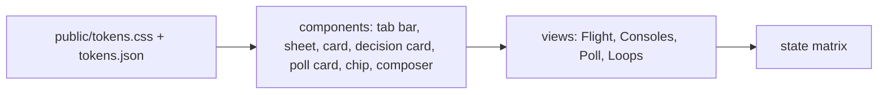

# DESIGN - Mission Control App

## Identity

The founder runs a fleet of agents from a phone, often away from the desk, in
short glances between other things: is anything waiting on me, what is each
console doing, answer it, move on. The same page opens on the laptop beside the
terminal. It is a control surface, read in seconds and operated with a thumb.

**The deciding sentence:** a glance answers "is anything waiting on me", and one
tap answers it; everything else is one sheet away.

Concept approved by the founder on 2026-10-15 (artifact "Mission Control App",
B341vXjnNZyzQiHRGJwGPq). The palette is the portfolio's own page system
(`.claude/skills/DESIGN.md`) extended with five state pairs, so a report and the
app read as one family.

## Tokens - `public/tokens.css` (mirrored in `tokens.json`, DTCG)

No raw value is written outside the token file. `tools/token-lint.sh tools/app`
holds the count of exceptions to the baseline in `.token-lint.json`, which is at
the floor: hex 0, spacing 0. Any raw colour or spacing value added to a view
fails the check.

| Role | Light | Dark | Use | Contrast pair (light / dark) |
|---|---|---|---|---|
| `--bg` | `#FFFFFF` | `#111819` | page ground | |
| `--surface` | `#F1F5F5` | `#182123` | composer, chips, panels | |
| `--raised` | `#FFFFFF` | `#1D2729` | cards, sheets | |
| `--line` | `#D3DDDE` | `#2B3A3D` | rules, borders | decorative |
| `--ink` | `#1B2A2E` | `#E4EDEE` | text | on bg 14.82 / 15.10 |
| `--ink-soft` | `#44575C` | `#B3C3C6` | secondary text | on surface 6.92 / 9.01 |
| `--ink-faint` | `#56696E` | `#94A8AC` | captions, times | on surface 5.25 / 6.60 |
| `--accent` | `#0A6A70` | `#5CC4CB` | the one primary action, active tab | on bg 6.35 / 8.74 |
| `--accent-ink` | `#FFFFFF` | `#0B1415` | text on accent | on accent 6.35 / 9.08 |
| `--run` / `--run-tint` | `#0A6A70` / `#DDF0F1` | `#5CC4CB` / `#173538` | running | 5.38 / 6.37 |
| `--wait` / `--wait-tint` | `#8A5A00` / `#FBEFD5` | `#F0C26A` / `#3A2E14` | waiting on the founder | 5.20 / 7.99 |
| `--fail` / `--fail-tint` | `#A3262A` / `#F8E1E1` | `#F29A9C` / `#3D1E1F` | stopped, no-go, errors | 5.87 / 7.04 |
| `--done` / `--done-tint` | `#2E6B2F` / `#E2F1E0` | `#8FD48F` / `#1E3520` | go, done | 5.49 / 7.56 |
| `--idle` / `--idle-tint` | `#56696E` / `#E9EEEF` | `#94A8AC` / `#222D2F` | idle, stood down | 4.93 / 5.70 |

Ratios computed with the WCAG relative-luminance formula on 2026-10-15; the
lowest text pair is idle on its tint, 4.93:1, above 4.5:1. Text on a solid `.go` button uses
`--bg` on `--done` (6.44 / 10.25).

**Call-sign colours** `--slot-1` to `--slot-8`: each Controller's own colour,
the fill of its call-sign chip wherever the app names it (Call-sign chip, below).
Chip text is `--bg` on the fill; the outlined Loops filter uses the colour as text
on `--surface`.

| Slot | Light | Dark | `--bg` on the fill (light / dark) | As text on surface (light / dark) |
|---|---|---|---|---|
| `--slot-1` | `#1C4E88` | `#458FE9` | 8.42 / 5.44 | 7.66 / 4.97 |
| `--slot-2` | `#A4592B` | `#D2743A` | 5.20 / 5.39 | 4.73 / 4.92 |
| `--slot-3` | `#824AE4` | `#BEAEF2` | 5.19 / 9.01 | 4.72 / 8.22 |
| `--slot-4` | `#86256D` | `#ED48C2` | 8.40 / 5.40 | 7.65 / 4.92 |
| `--slot-5` | `#746F2A` | `#968F38` | 5.19 / 5.38 | 4.72 / 4.91 |
| `--slot-6` | `#2E748E` | `#52C5ED` | 5.24 / 9.04 | 4.77 / 8.25 |
| `--slot-7` | `#8F30AA` | `#D580EE` | 6.62 / 6.98 | 6.03 / 6.37 |
| `--slot-8` | `#3233CE` | `#899EED` | 8.40 / 7.00 | 7.65 / 6.39 |

Measured 2026-10-16 with the same formula; every pair is above 4.5:1. Slots are
handed out lowest first, so the first ones are the most distinct: CIEDE2000
distance between any two of the first four is at least 21.7 light and 22.9 dark,
and between any two of all eight at least 11.1 and 10.7. The nearest state
colour is `--run` to `--slot-6` (10.5 / 10.6). Under simulated protanopia and
deuteranopia some pairs come close (as low as 1.6), so colour is never the only
carrier: the chip always shows the call sign. A call sign with no slot (a ninth
live Controller, or one stood down before colours were kept) is drawn with the
`--idle` fill, `--bg` text 5.77 / 7.24.

**Spacing scale:** `--s1` 4 · `--s2` 8 · `--s3` 12 · `--s4` 16 · `--s5` 24 · `--s6` 32 px.
**Type scale:** `--t-xs` 12/16 · `--t-sm` 13/18 · `--t-md` 15/22 · `--t-lg` 18/24 px; system faces
only (`--sans` and `--mono`, the full stacks in `public/tokens.css`), because the app is served
from the founder's machine and must load nothing remote.
**Layout and motion tokens:** `--target` 44 px (the minimum target) · `--r-field` 12 px (fields, buttons) · `--lh-*` line heights paired with each `--t-*` · `--scrim` (sheet backdrop) · `--rise` 220 ms (sheet entry) · `--pulse` 1.2 s and `--pulse-step` .2 s (the working dots) · `--dim` .25 (their low point) · `--bubble` 88% (message width) · `--toast-lift` 96 px (toast above the bars) · `--prof-max` the smaller of 9.5 em and 40% of the screen (the profile switcher's widest; a longer name ends in an ellipsis) · `--att-name` 8 em (a file's name in the attachment tray before its ellipsis).
**Letter spacing:** `--ls-1` .03em (button labels) · `--ls-2` .04em (call signs) · `--ls-3` .06em (small caps tags) · `--ls-4` .08em (section labels).
**Radius · elevation · motion:** `--r-chip` 999px · `--r-card` 16px · `--r-sheet` 22px;
no shadows; sheets rise 220 ms ease-out, and nothing
moves under `prefers-reduced-motion: reduce`.

## Components

| Component | States | Pattern it follows | Notes |
|---|---|---|---|
| Tab bar | default, selected, badge, focus | iOS tab bar / Material navigation bar (4 destinations) | bottom, thumb zone; Poll badge = what waits on the founder: open questions not yet sent to Flight, open to-dos, and undelivered decisions |
| Composer | empty, typing, with attachments, sending, queued, refused | messaging composer | `/` opens the command sheet; the paperclip attaches files (Attachments); Enter sends on desktop. A queued message shows as the founder's bubble until Flight's transcript holds it, or until the fleet answers its op itself (a console command such as list); a slash command reads back as typed, never as the engine's command tags |
| Command sheet | open, filtered, empty result | bottom sheet + search | grouped by source; "at the Mac" mark for terminal menus |
| Console card | running, waiting, idle, stood down, failed, focus | list card with a state stripe | stripe + pill, never colour alone |
| Console sheet | default, retuning, confirming stand-down | bottom sheet | Call, Retune, Stand down; destructive action confirms in-page |
| Decision card | unanswered, option picked, sending, sent to Flight (an answer can still be changed), Controller stood down (the answer is held) | action card in the Flight tab, the same anatomy as the Question card | A Controller's question, asked in Flight's chat beneath the messages, one card per open question, oldest first. The meta line is the call-sign chip, then `· id · time` (the time it was asked). The question in regular weight at `--t-md`; each option a full-width `.ask-opt` button of `--target` height or more, its label bold and what it does beneath in `--ink-soft`; one option is picked at a time (`aria-pressed`). A note field (optional) and Send answer (`.go`, disabled until an option is picked) follow; the report the question came from sits behind a details row, "The report it came from". A sent answer reads "Sent to Flight: 2) <label>. It runs once Flight is free." and the options stay live: picking another and Change answer replaces it until Flight has delivered it, and Send again repeats the same option (a plugin reload drops the first one's code). A legacy report's blocked line is asked the same way with two options, Go and No-go; a contract change that names dependent fronts is asked with Tell them and Don't tell. When the raising Controller has stood down the card says the answer is held for the next Controller under its call sign. Each card is `#ask-<id>` so the Poll can open it |
| Poll card | open question (waiting, sent), to-do (open), held, undelivered (Controller staffed, replaced, gone; retry sent), history row | read-only status card | The Poll answers nothing itself: it lists. Every card has the same meta line, the call-sign chip then `· id · time` (asked, held or decided, whichever the card is about), and the same details row, "The report it came from", where there is a report. Titles are regular weight. An open question shows its state in one line ("Waiting for your answer" or "Sent to Flight: 2) <label>") and one ghost button, Answer in Flight, which opens the Flight tab at that question's Decision card; when its Controller has stood down it adds Dismiss (`.warn`), which closes it with nothing sent. A to-do (`.gate.todo`) is an action only the founder can take, with its link; Done (`.go.secondary`) checks it off with nothing sent, and it moves to the history. A held decision (`.gate.held`, on the idle tint, under "Held for the next Controller") names the answer and the call sign, says the next Controller staffed under that call sign gets it with its staffing, and offers Dismiss only (`.warn`). An undelivered decision (`.gate.undelivered`) says why in one plain sentence, with the engine's own words behind Technical details; while the raising Controller is staffed it offers Retry (outlined) and a neutral Dismiss (`.ghost`), otherwise Dismiss only (`.warn`); a Retry sent to Flight reads "Retry sent to Flight" and takes no second tap. History rows show the answer (the option's label, Go, No-go, Done or Dismissed) as a state chip. No card on the Poll carries GO or NO-GO |
| Question card | unanswered, option picked, typing, sending (Send answer disabled until one question is answered) | action card in the Flight tab | Flight's own question, not a Controller's (that is the Decision card): each question shows its options (single or pick-any), an "Or type your own answer" box, or a text or number input; one answer is enough to send; the answer returns to the session as the question tool's own answer; at the Mac the same question is answered with `/console answer` |
| Destructive button | default, focus | `.danger`, tinted fill | stand down, dismiss all, stop the server; always behind an in-page confirm |
| Tags | default | `.tag` for values (model, budget), `.kindtag` for a loop row's kind | two jobs, two looks, on purpose; a call sign is never a tag, it is a Call-sign chip |
| Call-sign chip | slot 1 to 8, no slot (idle fill), Loops filter (outlined in the slot colour; pressed, filled) | identity chip: one colour per person, as in chat and calendar apps | `.call` plus `.slot-N`; wherever the app names a Controller: Flight message headers, Consoles rows and sheets, Poll cards and decided rows, Loops filters and rows. The colour comes from the snapshot's `slots`, which the fleet keeps per call sign in its store: given at staffing, kept across reloads and sessions, and never shared by two live Controllers. A Flight message carries chips only when its first line is the marker (`public/badge.js`): its call signs in bold, joined by a middle dot or a space, every one known to the fleet, the marker ending at a space, a colon or the line's end; a bold call sign run into a word, or one named in the body, stays text. The label carries the identity; the colour only helps the eye find it |
| State chip | five states | tinted pill | label carries the state |
| Loop row | status, call, decision, advisory | timeline row | advisory rows tinted `--wait-tint` |
| Toast | info, error | snackbar | announced via `role="status"`; an op Flight runs later reads as sent, never done (Relayed console actions, below) |
| Profile switcher | hidden (before the first listing, while fewer than two profiles are listed, or while the Mac cannot be reached), current, attention dot, sheet open, not answering | header button + bottom sheet of `.prof` rows | shows the current Claude profile, always a listed one, while another is running to switch to: the app names and connects to none until the first listing, and the first listing that names a profile opens the remembered profile if it is listed, else the front door's own (the profile whose server holds 4777), else the first listed; the dot means another profile has something waiting on the founder (`busy` colour) or is working (`live`); each row carries a state chip; the choice is remembered per device, and so is an automatic move; a long name ends in an ellipsis in the button and wraps in its row |
| Attachments | hidden, picked (1 to 10), sending (locked), refused (toast) | paperclip button beside `/` + a tray above the composer | the paperclip ("Attach photos or files") opens a picker for several files: photos, downscaled on the device to 1600 px JPEG, and PDF, `.txt`, `.md`, `.csv` or `.json` files, sent as they are. At most 8 MB a file, 10 files and 32 MB a message, checked in the page before a file joins and again by the server, which reads each file's own bytes; files not added are named in one toast with why. The tray scrolls sideways in its own row: each item, on `--surface` with a `--line` border and `--r-field` corners, holds a photo thumbnail or a type badge (`.ftype`, the extension in mono), the name ending in an ellipsis at `--att-name`, and a remove button of `--target` size named "Remove <name>"; a hint line reads "3 of 10 files · 4.1 of 32 MB". A slash command with attachments is refused ("Remove the attachments to run a command."). Each file travels as one line at the end of the message naming its stored path; the line is never shown |
| Sent photos | one, several, loading, gone | inside the sent bubble, above its text | one at most 40 vh high; several in a two-column grid of square crops; a photo still loading, or no longer on the Mac, is a `--surface` placeholder that says so |
| Document chip | loading, ready (a link), gone | inline chip in the sent bubble, below its photos | on `--surface` with a `--line` border, `--r-field` corners and `--target` high: the type badge and the name, ending in an ellipsis. Ready, it opens the file in a new tab from a blob of a fixed type (a PDF as PDF, every text file as plain text), fetched with the token in a header so the token never sits in the page; loading reads "<name> · loading", gone "<name> · no longer on the Mac". On the accent bubble its focus ring is `--accent-ink` |
| Theme choice | System (default), Light, Dark | a segmented control in the menu sheet | kept per device in localStorage; `public/theme.js` sets `data-theme` on `<html>` before first paint (the CSP allows no inline script); `tokens.css` applies the dark palette for a dark device unless Light is chosen, and always for Dark |
| Markdown reply | default, badged (a first-line call-sign marker) | rendered by `public/md.js` | headings, emphasis, code, lists, quotes, http(s) links in a new tab, tables in their own horizontal scroll; text escaped before markup; a first-line marker becomes Call-sign chips beside FLIGHT and leaves the text |

## Relayed console actions

A staffing, call, answer to a Controller's question, Retry, dismissal or
stand-down sent from the app reaches Flight as a prompt and runs once Flight's
current turn ends, so the app never reports one as done: its words are "sent to
Flight" and "runs once Flight is free", as on a Decision card and in the fleet's
own result toast. An answer sent again before Flight has run the first replaces
it: the first one's code stops working and the card shows the newer option.
Dismissing a poll item, checking off a to-do, retuning and stopping the app run
at once. A tap that sends several ops says what it sent in one toast: Dismiss
all reads "2 dismissals sent to Flight; they run once Flight is free.", and when
an op is not sent the toast is an error naming each console left out, with the
reason. The fleet's toast for each op that summary covers is not shown over it.

## State matrix

| View | Empty | Loading | Error | Long content | Direction | Narrow |
|---|---|---|---|---|---|---|
| Flight | "No messages yet. Ask Flight anything, or tap / for a command." With no open question no Decision card shows. A message with no marker reads FLIGHT alone; a marker naming a call sign the fleet does not know stays text, unbadged | the link line reads "Connecting to Flight…"; a sent file not yet fetched reads "loading" in its place | link line "Reconnecting…" (EventSource retries); a refused send shows the server's reason; a sent file the Mac no longer keeps reads "no longer on the Mac"; an answer that could not be delivered leaves the chat and shows on the Poll as undelivered | messages wrap; code blocks scroll in their own box; several chips wrap beside FLIGHT; a long call sign wraps inside its chip; several photos sit in a two-column grid and document chips wrap, each name ending in an ellipsis; several open questions stack as Decision cards, oldest first, each option's label and what it does wrapping inside its button | LTR only, stated | 320 px, one column |
| Attachment tray | hidden | the items lock (remove buttons, the paperclip and the draft disabled) and the hint reads "Sending 2 of 3…" | a refused pick names each file and why in one toast; a failed upload names the file and the server's reason and keeps the tray for a retry, which does not send a stored file twice | names end in an ellipsis, the full name kept in the remove button's name; ten items scroll in their own row | LTR | 320 px: the row scrolls sideways with no page scroll |
| Consoles | "No consoles staffed." + the `/console staff` hint | four grey summary tiles | as Flight; a call sign with no slot gets the idle chip | task text wraps to 3 lines; the sheet shows all | LTR | 320 px |
| Poll | "Nothing is waiting on you. A Controller's questions are asked in Flight." (no question open, no to-do open, no decision undelivered; a held decision waits on a staffing, not on the founder, so its card can sit below this line) | summary only | as Flight; every undelivered decision shows in its own card with the plain reason, Retry (while its Controller is staffed) and Dismiss; every held decision shows in its own card with Dismiss | a title wraps, in regular weight; a to-do's link wraps; the report and the engine's words sit in scroll boxes; history keeps the last six answers and the last three replaced questions | LTR | 320 px |
| Loops | "No loop traffic yet." | none (data arrives with state) | as Flight | first line only; tap expands; a row's route names each known Controller with its chip | LTR | 320 px, filter chips scroll sideways in their own row |
| Header and profiles sheet | no profile listed: the front door's own Flight is shown unnamed, switcher hidden, the remembered profile kept and nothing said about it, and the next listing that names a profile decides as on open; a sheet left open reads "No Flight is running. Type /console app in a Claude session." | before the first listing: no profile named, switcher hidden, link line "Connecting to Flight…"; a send waits with "Still connecting to Flight. Try again in a moment." | Mac unreachable: link line "Not connected: sign in to Tailscale, or open the link /console app printed", switcher hidden; an open profiles sheet reads "Can't reach the Mac to list profiles; trying again."; the Mac reached but the current profile's Flight not answering: link line "Flight not answering; retrying", the cause first so a narrow header still shows it; a remembered or current profile that stopped: one line, "Personal is not running; showing Work." | many profiles: the sheet lists every one and scrolls; a long name ends in an ellipsis in the header button and wraps in its row | LTR | 320 px: title, switcher and menu stay on one line |

## Desktop (1024 px and wider)

The four destinations move to a left navigation rail (`--rail`) with the Poll badge beside its label; Flight's conversation and composer sit at a reading width (`--read`); Consoles and Poll lay their cards in columns (`--card-min`); sheets float as centred panels. Below 1024 px the phone layout is unchanged.

## Profiles

One server runs per Claude profile (work, personal and any other config). The one that holds the shared front-door port, 4777, serves the app and every other profile's data through `/p/<profile>/`, so one URL and one token cover every profile, and the front door survives any single session closing. The profile switcher in the header names the current profile and lists the live profiles with an attention dot while two or more are running; with one running there is nothing to switch to, so it is hidden, as it is while no profile is listed or the Mac cannot be reached. The remembered choice is a wish, not the state: on open the app names no profile and connects to none until the first listing, and the first listing that names a profile decides: the remembered profile when it is listed, else the front door's own, else the first listed, remembering the one it opened and saying so in one line when the remembered one was not running. A listing with no profile in it opens the front door's own Flight unnamed and leaves the remembered choice alone. A profile missing from two timed listings in a row (a restarting server misses one) is left the same way, and that move is remembered too, so a profile that starts again never pulls the app back unasked. The listing a tap on the switcher asks for refreshes the sheet but is never counted as a miss. A profile already running refuses a second server for itself.

## Platform (mobile fronts)

A web app installed to the home screen (PWA manifest, standalone display). It
follows iOS and Material behaviour where they agree: bottom navigation with four
destinations, bottom sheets for detail, 44 px minimum targets, safe-area insets
on the bars; a sheet closes with its close button, the scrim or Escape. Departures: the system back gesture does not close a sheet yet (no history entries are pushed); no
pull-to-refresh (the stream is live), no swipe actions (one tap is enough and
discoverable).

## Quality bar

- Contrast: every pair above at 4.5:1 or more in both themes, recomputed when a value changes.
- Shipping sizes: 320, 390 and 1280 px wide.
- Themes: light and dark, following the system setting unless the founder picks Light or Dark in the menu (Theme choice).
- Offline: no http(s) load other than the app's own origin (CSP `default-src 'self'`).
- Accessibility: every control reachable by keyboard with a visible focus; every icon-only control (tab icons, the `/` button, sheet close) carries an accessible name; live regions for toasts and the link line; the gate is axe-core with no violations, run on a view when it changes.
- Visual baselines: screenshots at 390 px, light and dark, taken when a view changes and kept with that change's evidence, not in this repo.
